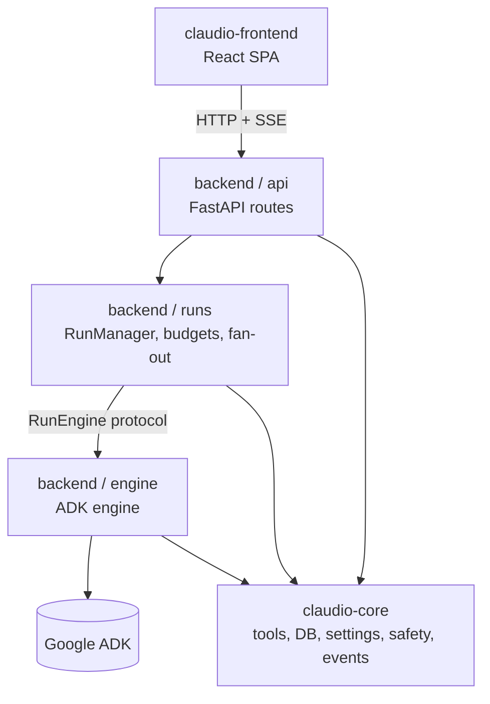

# Claudio

A local-first agentic coding assistant: a chat surface that drives real tools in a
workspace, with human approval on destructive actions, budget tracking, context
compaction, and an autonomous maintenance daemon.

This repository is the **refactored three-project layout**. Claudio was originally
built on the OpenAI Agents SDK. It has been moved to Google ADK behind a
framework-neutral core, so that the agent framework is a replaceable component
rather than a load-bearing assumption.

**Current status: migration complete and operational.** Core is extracted and
verified, the ADK engine is written, backend orchestration, HTTP routes and the
autonomous daemon are ported, the self-improvement loop is live, and the backend
serves traffic.

---

## Recent updates

### Web search reliability

The `web_search` tool no longer relies on keyless HTML scraping as its primary
path. A CAPTCHA-blocked provider used to return HTTP 200 with cached, unrelated
junk, and the old tool accepted it as success — so a capable agent looked
incompetent on any web-dependent task. What changed:

- **Keyed search APIs** (Brave / Serper / Tavily) are now the preferred path.
  They return stable, structured JSON and are not subject to bot-walls. Keyless
  scraping (Bing / DuckDuckGo) is kept only as a fallback.
- **Relevance gate.** Every provider's results are scored against the query; a
  response that shares no content with the query is treated as a failure and the
  next provider is tried, instead of junk passing through as success.
- **Bot-wall detection.** CAPTCHA / block pages are recognized and rejected
  rather than parsed as results.
- **Honest degraded output.** If no provider yields relevant results, the call
  returns `ok=false` with a `degraded` flag instead of fabricating success.
- **Search-hygiene rules** added to the system prompt and the
  `information-gathering` skill: run a control query first, stop rephrasing a
  failing query, route around a dead search with a direct fetch, treat results
  as untrusted, and report verified vs. unverifiable claims.
- **Pre-flight health check** in the benchmark harness: backend, LLM and search
  are probed before any scoring, so an environment failure is reported up front
  instead of being charged to the agent.
- **New `search:` config section** — provider selection, per-provider API keys,
  language/country, `min_relevance`, `timeout_seconds`. See
  [Configuration](#configuration) below.

---

## Why this refactor

The original coupling ran deeper than an import statement. `agents.*` appeared in
21 of 55 modules: tool definitions, guardrails, run configuration, retry and
input-filtering, session state. Any change to the framework meant touching most
of the codebase, and evaluating a different framework was impossible without a
rewrite.

The fix is not "swap the framework." It is to **put a boundary in the right
place first**. Three rules govern the layout:

1. **The event protocol is the contract, not the framework.** Everything the UI
   needs is a stream of 13 typed events. That protocol is frozen in
   `claudio_core/events.py` and neither side may change it unilaterally.
2. **Core knows nothing about any agent framework.** Enforced mechanically by
   import-linter, not by convention.
3. **Exactly one package in the backend touches ADK.** Also enforced by
   import-linter.

The result: swapping the engine later is a change to one subpackage.

---

## Architecture

Claudio is **one long-lived agent** with **two independent client surfaces**. The
agent is the only component that owns state and guarantees that running work stays
consistent; the Web UI and the VS Code extension are clients that display what the
agent is doing and let a human steer it. Either client can be closed, crash, or be
restarted at any moment and the agent keeps running exactly as before — when a
client comes back it reconnects and catches up. Two disposable windows, one
durable process.

The agent is five cooperating components, each with one job:

| Component | Responsibility |
|---|---|
| **RunManager** | Owns every run's lifecycle — create, start, pause, resume, complete, cancel. |
| **Tool execution** | Runs file edits, shell commands, web fetch/search in order, in one process. |
| **Approvals** | Gates destructive actions; a run pauses until a decision arrives from any client. |
| **Scheduled jobs** | Cron-style tasks that fire on the agent's own clock, independent of clients. |
| **Self-maintenance loop** | Watches the system, runs upkeep, recovers from failures, turns learnings into skills. |

Both clients are peers: identical access over the same versioned HTTP API
(`/api/v1`) and the same frozen SSE event protocol (`claudio_core/events.py`),
no local authority. The full write-up — guarantees, the component view,
disconnect/reconnect semantics, invariants and diagrams — is in
[doc/architecture.md](./doc/architecture.md).

---

## Layout

```
claudio/
├── claudio-core/             framework-free domain: tools, storage, settings,
│                             safety, event protocol, self-improvement capture
├── claudio-backend/          Google ADK engine + FastAPI deployable + daemon
├── claudio-frontend/         React SPA
├── doc/
│   ├── architecture.md       one agent, two clients — system architecture
│   ├── core.md               capabilities, API, structure
│   ├── backend.md            engine internals, full endpoint reference
│   ├── frontend.md           views, SSE handling, contract mirror
│   ├── skills-and-workspace.md   skills/workspace paths and resolution
│   ├── skills-refresh-prompt.md  refresh the curated skill set
│   └── claudio_full_spec.md  the original rebuild specification (historical)
├── todo/                     working task notes
├── backend-start.sh          daemon launcher (uvicorn + healthcheck + pid)
└── backend-stop.sh           daemon stopper (graceful SIGTERM)
```



The two import-linter contracts that hold this together:

| Contract | Enforced in | Rule |
|---|---|---|
| core is framework-free | `claudio-core` | core may not import `agents`, `google`, `openai`, `litellm`, `langgraph`, `semantic_kernel` |
| only the engine knows about ADK | `claudio-backend` | `api` and `runs` may not import `google`, `litellm`, `langgraph`, `semantic_kernel` |

---

## What each project does

### claudio-core

Extracted, not rewritten. Nine modules came across verbatim because they never
touched the framework; nine more were de-tainted by replacing framework types
with plain data.

| Capability | Module |
|---|---|
| SQLite storage | `db.py` |
| Settings, hot reload, secret redaction | `settings.py` |
| Tool implementations | `tools/` |
| Instruction assembly | `instructions.py` |
| File extraction (text/pdf/docx/xlsx/image) | `extract.py`, `file_context.py` |
| Memory file discovery | `memory.py` |
| Skill loading | `skill_loader.py` |
| Command allowlist, output screening | `safety/` |
| Context compaction | `compaction.py` |
| Token estimation, input filtering | `recovery.py` |
| Metrics | `metrics.py`, `engine_metrics.py` |
| Logging | `logging_setup.py` |
| **Frozen SSE event protocol** | `events.py` |
| **`RunEngine` protocol** | `engine.py` |
| Direct OpenAI-compatible calls | `llm.py` |
| Self-improvement capture (episodic learnings) | `learning.py` |

Details: [doc/core.md](./doc/core.md)

### claudio-backend

The ADK deployable. `engine/adk_engine.py` implements core's `RunEngine` over
ADK: wrapped tools with synthetic signatures, confirmation-based pause,
cross-process resume, and event translation from ADK's shape into Claudio's.

The rest — `RunManager`, HTTP routes and the autonomous daemon — is ported and
running. See [doc/backend.md](./doc/backend.md) for the full API and structure.

### claudio-frontend

Vite + React 18 + TypeScript + Tailwind 4. Six views: chat, config, workspace,
monitor, tasks, memory. Handles SSE reconnection, approval round-trips,
context-usage display, file attachment, and the self-improvement Memory view.

Details: [doc/frontend.md](./doc/frontend.md)

---

## Running it

### Prerequisites

- Python 3.11 or newer
- Node.js 20 or newer
- An OpenAI-compatible endpoint (local or remote)

### Start / stop

The backend runs as a daemon managed by two scripts at the repo root:

```bash
./backend-start.sh    # launches uvicorn, waits for /healthz, writes a pid file
./backend-stop.sh     # graceful SIGTERM, 20s grace, then SIGKILL
```

`backend-start.sh` reads host/port from `claudio-backend/config/config.yaml`
(defaults to `127.0.0.1:8100`), logs to
`claudio-backend/data/logs/backend.log`, and stores the PID in
`claudio-backend/data/claudio.pid`. If the venv is missing it creates one and
installs core + backend.

The frontend dev server is not daemonized — run it in its own terminal:

```bash
cd claudio-frontend
npm run dev           # http://localhost:5173, Ctrl-C to stop
```

To run the frontend against the backend, start the backend first, then the
frontend (Vite proxies `/api` to `http://127.0.0.1:8100`).

### Rebuild everything

After pulling changes, or to rebuild all three projects from scratch:

```bash
# core
cd claudio-core
.venv/bin/pip install -e ".[dev]"

# backend
cd ../claudio-backend
.venv/bin/pip install -e ".[dev]"

# frontend
cd ../claudio-frontend
npm install
npm run build         # produces dist/
```

If a venv does not exist yet, create it first with
`python -m venv .venv` inside `claudio-core` / `claudio-backend`.

### Core

Standalone; no server.

```bash
cd claudio-core
python -m venv .venv
.venv/bin/pip install -e ".[dev]"

.venv/bin/python -m pytest -q     # 134 tests
.venv/bin/lint-imports            # core is framework-free: KEPT
```

### Backend

Ported and running end to end — `RunManager`, the HTTP API and the
autonomous daemon all serve traffic.

```bash
cd claudio-backend
python -m venv .venv
.venv/bin/pip install -e ".[dev]"

.venv/bin/python -m pytest -q     # 61 tests
.venv/bin/lint-imports            # only the engine knows about ADK: KEPT
```

Or drive it as a daemon from the repo root with `./backend-start.sh` /
`./backend-stop.sh` (see **Start / stop** above).

### Frontend

```bash
cd claudio-frontend
npm install
npm run dev        # http://localhost:5173
npm run build      # produces dist/
```

Vite proxies `/api` to `http://127.0.0.1:8100`.

### Configuration

Claudio reads `claudio-backend/config/config.yaml` (the live, gitignored
config; a fresh clone falls back to the built-in defaults in
`claudio_core/settings.py`). Every key can be overridden by environment
variable using the `CLAUDIO__` prefix and `__` as the separator:

```bash
export CLAUDIO__LLM__BASE_URL="http://localhost:8081/v1"
export CLAUDIO__LLM__MODEL="qwen3-coder"
export CLAUDIO__SERVER__AUTH_TOKEN="change-me"
```

The essential keys:

```yaml
server:
  host: 127.0.0.1
  port: 8100
  auth_token: "change-me"        # Bearer token; empty = deny-all, not open

llm:
  provider: openai
  model: "qwen3-coder"
  base_url: "http://localhost:8081/v1"
  api_key: "local"
  max_tokens: 16384

agent:
  workspace_dir: ./data/workspace   # relative to process cwd — see note
  approval_mode: on_request      # auto | on_request | always
  max_turns: 50
  max_budget_usd: 5.0
  context_window: 32768
  skills_enabled: true
  skills_dir: ./skills           # relative to claudio-backend/ (cwd-independent)

self_improvement:
  enabled: false                 # master switch for the learn→distill→promote loop
  capture_enabled: true          # extract learnings after each run
  consolidation_schedule: "0 4 * * 1"   # weekly, Mon 04:00 UTC
  promotion_threshold: 3        # recurrence_count >= N promotes
  auto_promote: false           # apply skill changes without approval (trusted hosts only)
```

**Two directory gotchas.** The skills dir (`./skills`) is anchored to
`claudio-backend/` regardless of where the backend is launched, but the
workspace (`./data/workspace`) is anchored to the **process working
directory** — so launch `backend-start.sh` from the repo root, or set
`workspace_dir` to an absolute path. Full detail in
[`doc/skills-and-workspace.md`](./doc/skills-and-workspace.md).

The config API exposes the full JSON schema at `GET /api/v1/config/schema`.
The same schema is available without a server from
`claudio_core.settings.config_schema_json()`. `PUT /config` is a
**merge-patch** over the current config — send only the keys you want to
change.

## Core skills documentation

### Claudio self-management
claudio-autonomy — full self-management loop (self-check, self-config, scheduling, learning, escalation)
claudio-self-check — health check on services, config drift, skills, tasks, cost, logs
claudio-self-config — read/validate/change/roll back my own config via HTTP API
claudio-self-scheduling — create, update, enable and verify cron-scheduled tasks

### Planning & tool use
agent-planning — authoring plans, decomposing goals, sequencing, tracking, recovery, multi-agent orchestration
agent-tools-usage — tool selection, correct calls, error handling, chaining, MCP servers and .mcp.json wiring
claude-extension-authoring — skills, slash commands, subagents, hooks, plugin scaffolding, hookify rules

### Engineering
coding — writing, reviewing, refactoring, testing, lint, PR stacking, ticket-to-scope
debugging — hypotheses, isolation, traces/logs, debuggers, fix confirmation
software-architecture — boundaries, patterns, services and data models, tradeoffs
testing-and-verification — e2e/behavior/integration/smoke/pre-commit tests, snapshots
web-and-cli-frameworks — FastAPI (routing, validation, DI) and Typer (typed CLIs)
python-typing-and-tooling — type stubs/annotations, inference, version support, venv managers, path handling, profiling, safe monkey-patching
linux — shell/bash, files & processes, permissions, services, networking, performance, hardening, repo security scanning
embedded-devices — M5Stack ESP32 onboarding (UIFlow 2.0 flash), Cardputer-Adv MicroPython app iteration

### Research & analysis
information-gathering — search, source evaluation, synthesis, browser automation, multi-source research with citation
mathematics — olympiad/competition problem solving (IMO, Putnam, USAMO, AIME) with adversarial verification and sustained proof work
usage-analytics-and-cost — usage/impact reports, HTML session reports, token & cache audits, JSONL log diagnosis

### Documents & design
documents-and-knowledge-artifacts — PDF/DOCX/XLSX/PPTX, LaTeX, explainers, reports, meeting notes, CLAUDE.md quality
visual-design-and-artifacts — frontend aesthetic direction, components, dataviz, sketch whiteboards, HTML playgrounds, design-system sync

### Integration
messaging-channel-integration — Discord, Telegram, iMessage setup, tokens, pairing approval, allowlists
Plus the SkillMD.com MCP server for searching/downloading/recommending community skills.

---

## Verification

| Check | Command | Result |
|---|---|---|
| Core unit tests | `cd claudio-core && .venv/bin/python -m pytest -q` | 134 passed |
| Core framework-free | `cd claudio-core && .venv/bin/lint-imports` | KEPT |
| Core end-to-end | DB, sessions, skills, instructions, tools, compaction, safety | passed |
| Backend engine import | `from claudio_backend.engine import create_engine` | OK |
| Backend ADK confinement | `cd claudio-backend && .venv/bin/lint-imports` | KEPT |
| Pause-state round-trip | `AdkPauseState.from_json(s.to_json())` | OK |
| ADK cross-process resume | fresh process resumes a run paused by an exited process | verified |
| Engine A/B | `cd claudio-backend && PYTHONPATH=src .venv/bin/python ../_engine_ab/ab_test.py` | 3 of 3 pass |
| Frontend typecheck | `cd claudio-frontend && npx tsc -b` | clean |
| Frontend build | `cd claudio-frontend && npm run build` | clean |

---

## Migration progress

| Step | What | State |
|---|---|---|
| 0 | Freeze the SSE wire contract | done, `claudio_core/events.py` |
| 1 | Extract framework-free core | done, 134 tests, contract KEPT |
| 1b | Frontend copy, build verified | done, `tsc -b` + `vite build` clean |
| 2a | ADK engine | done, `engine/adk_engine.py` |
| 2b | `RunManager` port | done, `runs/manager.py` |
| 2c | HTTP API port | done, `api/` (13 modules) |
| 2d | Engine flag-switch A/B harness | done, all 3 scenarios pass |
| 3 | Autonomous daemon port | done, `autonomous/` |
| 4 | Self-improvement loop | done, capture + consolidation + promotion |
| 5 | Delete `_upstream`, retire the old tree | pending |

`create_engine(config, db, kind=...)` selects the implementation from `kind`
then `$CLAUDIO_ENGINE` then `"adk"`. Only the ADK engine exists today; the
flag-switch mechanism is in place for a future second engine.

---

## Documentation index

| Document | Contents |
|---|---|
| [doc/architecture.md](./doc/architecture.md) | one agent, two clients — guarantees, components, disconnect/reconnect, invariants |
| [doc/core.md](./doc/core.md) | core capabilities, module-by-module API, file structure |
| [doc/backend.md](./doc/backend.md) | engine internals, complete endpoint reference, self-improvement loop, ADK integration notes |
| [doc/frontend.md](./doc/frontend.md) | views, SSE handling, contract mirror, build |
| [doc/skills-and-workspace.md](./doc/skills-and-workspace.md) | where the skills directory and workspace live, path resolution, skill folder format |
| [doc/skills-refresh-prompt.md](./doc/skills-refresh-prompt.md) | reusable prompt to refresh the curated skill set from skillmd.com, with owner/repo/credits manifest |
| [doc/claudio_full_spec.md](./doc/claudio_full_spec.md) | the original rebuild specification (historical design doc) |
