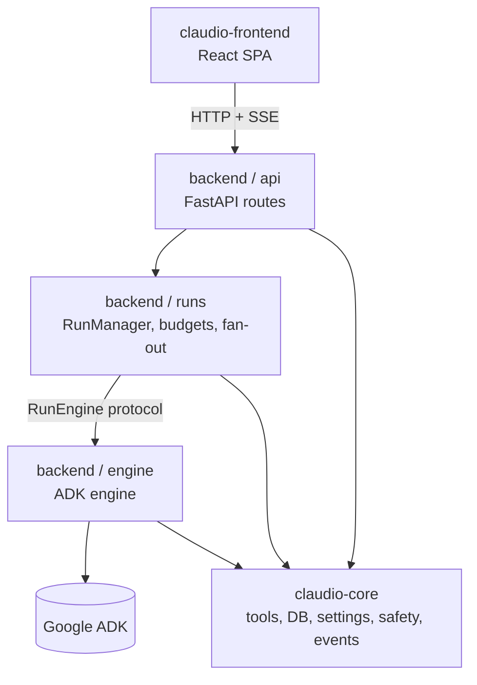

# Claudio

A local-first agentic coding assistant: a chat surface that drives real tools in a
workspace, with human approval on destructive actions, budget tracking, context
compaction, and an autonomous maintenance daemon.

This repository is the **refactored three-project layout**. Claudio was originally
built on the OpenAI Agents SDK. It is being moved to Google ADK behind a
framework-neutral core, so that the agent framework becomes a replaceable
component rather than a load-bearing assumption.

**Current status: migration complete and operational.** Core is extracted and
verified, the ADK engine is written, backend orchestration and HTTP routes are
ported, and the backend serves traffic.

---

## Why this refactor

The original coupling ran deeper than an import statement. `agents.*` appeared in
21 of 55 modules: tool definitions, guardrails, run configuration, retry and
input-filtering, session state. Any change to the framework meant touching most
of the codebase, and evaluating a different framework was impossible without a
rewrite.

The fix is not "swap the framework." It is to **put a boundary in the right
place first**. Three rules govern the layout:

1. **The event protocol is the contract, not the framework.** Everything the UI
   needs is a stream of 13 typed events. That protocol is frozen in
   `claudio_core/events.py` and neither side may change it unilaterally.
2. **Core knows nothing about any agent framework.** Enforced mechanically by
   import-linter, not by convention.
3. **Exactly one package in the backend touches ADK.** Also enforced by
   import-linter.

The result: swapping the engine later is a change to one subpackage.

---

## Layout

```
claudio/
├── claudio-core/             framework-free domain: tools, storage, settings,
│                             safety, event protocol
├── claudio-backend/          Google ADK engine + FastAPI deployable
├── claudio-frontend/         React SPA (unchanged)
├── doc/
│   ├── core.md               capabilities, API, structure
│   ├── backend.md            engine internals, full endpoint reference
│   └── frontend.md           views, SSE handling, contract mirror
├── refactoring_status.md     what is done, what is not, what is verified
├── claudio_refactoring.md    the original migration analysis
├── _engine_ab/               deterministic A/B harness, old engine vs ADK
├── _upstream/                the original repo, kept for reference
└── _deferred_backend_tests/  upstream tests parked during extraction
```

Anything prefixed `_` is scratch from the migration, not part of the product.



The two import-linter contracts that hold this together:

| Contract | Enforced in | Rule |
|---|---|---|
| core is framework-free | `claudio-core` | core may not import `agents`, `google`, `openai`, `litellm`, `langgraph`, `semantic_kernel` |
| only the engine knows about ADK | `claudio-backend` | `api` and `runs` may not import `google`, `litellm`, `langgraph`, `semantic_kernel` |

---

## What each project does

### claudio-core

Extracted, not rewritten. Nine modules came across verbatim because they never
touched the framework; nine more were de-tainted by replacing framework types
with plain data.

| Capability | Module |
|---|---|
| SQLite storage | `db.py` |
| Settings, hot reload, secret redaction | `settings.py` |
| Tool implementations | `tools/` |
| Instruction assembly | `instructions.py` |
| File extraction (text/pdf/docx/xlsx/image) | `extract.py`, `file_context.py` |
| Memory file discovery | `memory.py` |
| Skill loading | `skill_loader.py` |
| Command allowlist, output screening | `safety/` |
| Context compaction | `compaction.py` |
| Token estimation, input filtering | `recovery.py` |
| Metrics | `metrics.py`, `engine_metrics.py` |
| Logging | `logging_setup.py` |
| **Frozen SSE event protocol** | `events.py` |
| **`RunEngine` protocol** | `engine.py` |
| Direct OpenAI-compatible calls | `llm.py` |

Details: [doc/core.md](./doc/core.md)

### claudio-backend

The ADK deployable. `engine/adk_engine.py` implements core's `RunEngine` over
ADK: wrapped tools with synthetic signatures, confirmation-based pause,
cross-process resume, and event translation from ADK's shape into Claudio's.

The rest — `RunManager`, HTTP routes and the autonomous daemon — is ported and
running. See [doc/backend.md](./doc/backend.md) for the full API and structure.

### claudio-frontend

Vite + React 18 + TypeScript + Tailwind 4. Six views: chat, config, workspace,
monitor, tasks, memory. Handles SSE reconnection, approval round-trips,
context-usage display, file attachment, and the self-improvement Memory view.

Details: [doc/frontend.md](./doc/frontend.md)

---

## Running it

### Prerequisites

- Python 3.11 or newer
- Node.js 20 or newer
- An OpenAI-compatible endpoint (local or remote)

### Start / stop

The backend runs as a daemon managed by two scripts at the repo root:

```bash
./backend-start.sh    # launches uvicorn, waits for /healthz, writes a pid file
./backend-stop.sh     # graceful SIGTERM, 20s grace, then SIGKILL
```

`backend-start.sh` reads host/port from `claudio-backend/config/config.yaml`
(defaults to `127.0.0.1:8100`), logs to
`claudio-backend/data/logs/backend.log`, and stores the PID in
`claudio-backend/data/claudio.pid`. If the venv is missing it creates one and
installs core + backend.

The frontend dev server is not daemonized — run it in its own terminal:

```bash
cd claudio-frontend
npm run dev           # http://localhost:5173, Ctrl-C to stop
```

To run the frontend against the backend, start the backend first, then the
frontend (Vite proxies `/api` to `http://127.0.0.1:8100`).

### Rebuild everything

After pulling changes, or to rebuild all three projects from scratch:

```bash
# core
cd claudio-core
.venv/bin/pip install -e ".[dev]"

# backend
cd ../claudio-backend
.venv/bin/pip install -e ".[dev]"

# frontend
cd ../claudio-frontend
npm install
npm run build         # produces dist/
```

If a venv does not exist yet, create it first with
`python -m venv .venv` inside `claudio-core` / `claudio-backend`.

### Core

Standalone; no server.

```bash
cd claudio-core
python -m venv .venv
.venv/bin/pip install -e ".[dev]"

.venv/bin/python -m pytest -q     # 133 tests
.venv/bin/lint-imports            # core is framework-free: KEPT
```

### Backend

Not yet runnable end to end: `runs/manager.py` and `api/` still need porting.
The engine itself imports and its pause/resume behaviour is verified:

```bash
cd claudio-backend
python -m venv .venv
.venv/bin/pip install -e ".[dev]"

PYTHONPATH=src:../claudio-core/src .venv/bin/python -c "
from claudio_backend.engine import create_engine
from claudio_core import AppConfig
from claudio_core.db import Database
import pathlib, tempfile
db = Database(pathlib.Path(tempfile.mkdtemp()) / 't.db')
print(type(create_engine(AppConfig(), db)).__name__)   # AdkEngine
"

.venv/bin/lint-imports            # only the engine knows about ADK: KEPT
```

### Frontend

```bash
cd claudio-frontend
npm install
npm run dev        # http://localhost:5173
npm run build      # produces dist/
```

Vite proxies `/api` to `http://127.0.0.1:8100`.

### Configuration

Claudio reads `~/.claudio/config.yaml`. Every key can be overridden by
environment variable using the `CLAUDIO__` prefix and `__` as the separator:

```bash
export CLAUDIO__LLM__BASE_URL="http://localhost:8081/v1"
export CLAUDIO__LLM__MODEL="qwen3-coder"
export CLAUDIO__SERVER__AUTH_TOKEN="change-me"
```

The essential keys:

```yaml
server:
  host: 127.0.0.1
  port: 8100
  auth_token: "change-me"

llm:
  provider: openai
  model: "qwen3-coder"
  base_url: "http://localhost:8081/v1"
  api_key: "local"
  max_tokens: 16384

agent:
  workspace_dir: "~/claudio-workspace"
  approval_mode: on_request      # auto | on_request | always
  max_turns: 50
  max_budget_usd: 5.0
  context_window: 32768
  skills_enabled: true
```

The config API exposes the full JSON schema at `GET /api/v1/config/schema`. The
same schema is available without a server from
`claudio_core.settings.config_schema_json()`.

---

## Verification

| Check | Command | Result |
|---|---|---|
| Core unit tests | `cd claudio-core && .venv/bin/python -m pytest -q` | 133 passed |
| Core framework-free | `cd claudio-core && .venv/bin/lint-imports` | KEPT |
| Core end-to-end | DB, sessions, skills, instructions, tools, compaction, safety | passed |
| Backend engine import | `from claudio_backend.engine import create_engine` | OK |
| Backend ADK confinement | `cd claudio-backend && .venv/bin/lint-imports` | KEPT |
| Pause-state round-trip | `AdkPauseState.from_json(s.to_json())` | OK |
| ADK cross-process resume | fresh process resumes a run paused by an exited process | verified |
| Engine A/B | `cd claudio-backend && PYTHONPATH=src .venv/bin/python ../_engine_ab/ab_test.py` | 3 of 3 pass |
| Frontend typecheck | `cd claudio-frontend && npx tsc -b` | clean |
| Frontend build | `cd claudio-frontend && npm run build` | clean |

---

## Migration progress

| Step | What | State |
|---|---|---|
| 0 | Freeze the SSE wire contract | done, `claudio_core/events.py` |
| 1 | Extract framework-free core | done, 133 tests, contract KEPT |
| 1b | Frontend copy, build verified | done, `tsc -b` + `vite build` clean |
| 2a | ADK engine | done, `engine/adk_engine.py` |
| 2b | `RunManager` port | not started |
| 2c | HTTP API port | not started |
| 2d | Engine flag-switch A/B harness | done, all 3 scenarios pass |
| 3 | Autonomous daemon port | not started |
| 4 | Delete `_upstream`, retire the old tree | blocked on 2b, 2c, 3 |

`create_engine(config, db, kind=...)` already selects the implementation from
`kind` then `$CLAUDIO_ENGINE` then `"adk"`, so the flag-switch mechanism exists
even though the second implementation does not.

---

## Documentation index

| Document | Contents |
|---|---|
| [refactoring_status.md](./refactoring_status.md) | what is done, what is not, what was empirically verified |
| [doc/core.md](./doc/core.md) | core capabilities, module-by-module API, file structure |
| [doc/backend.md](./doc/backend.md) | engine internals, complete endpoint reference, ADK integration notes |
| [doc/frontend.md](./doc/frontend.md) | views, SSE handling, contract mirror, build |
| [doc/skills-and-workspace.md](./doc/skills-and-workspace.md) | where the skills directory and workspace live, path resolution, skill folder format |
| [doc/skills-refresh-prompt.md](./doc/skills-refresh-prompt.md) | reusable prompt to refresh the curated skill set from skillmd.com, with owner/repo/credits manifest |
| [claudio_refactoring.md](./claudio_refactoring.md) | the original migration analysis and framework comparison |
