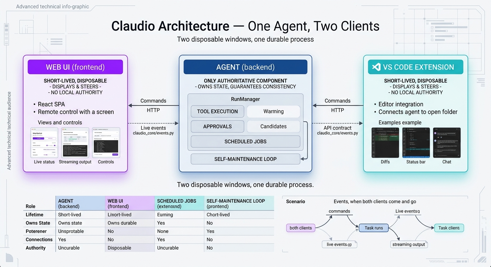
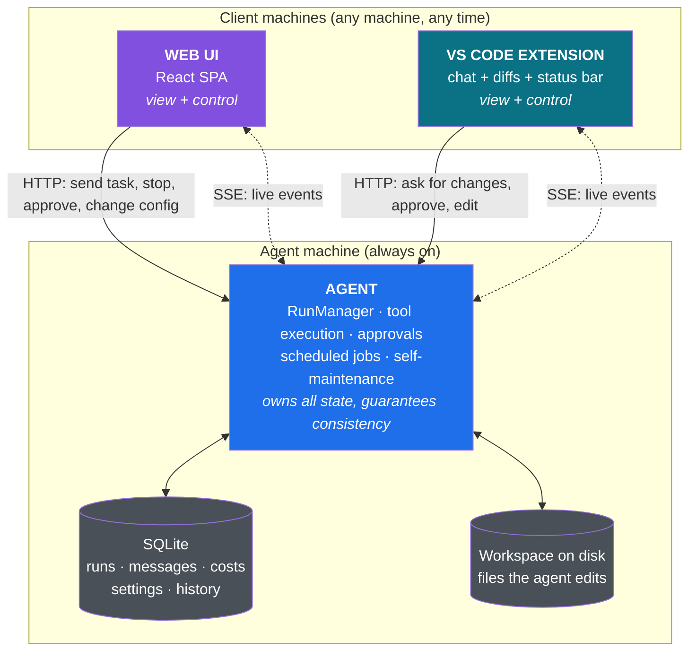
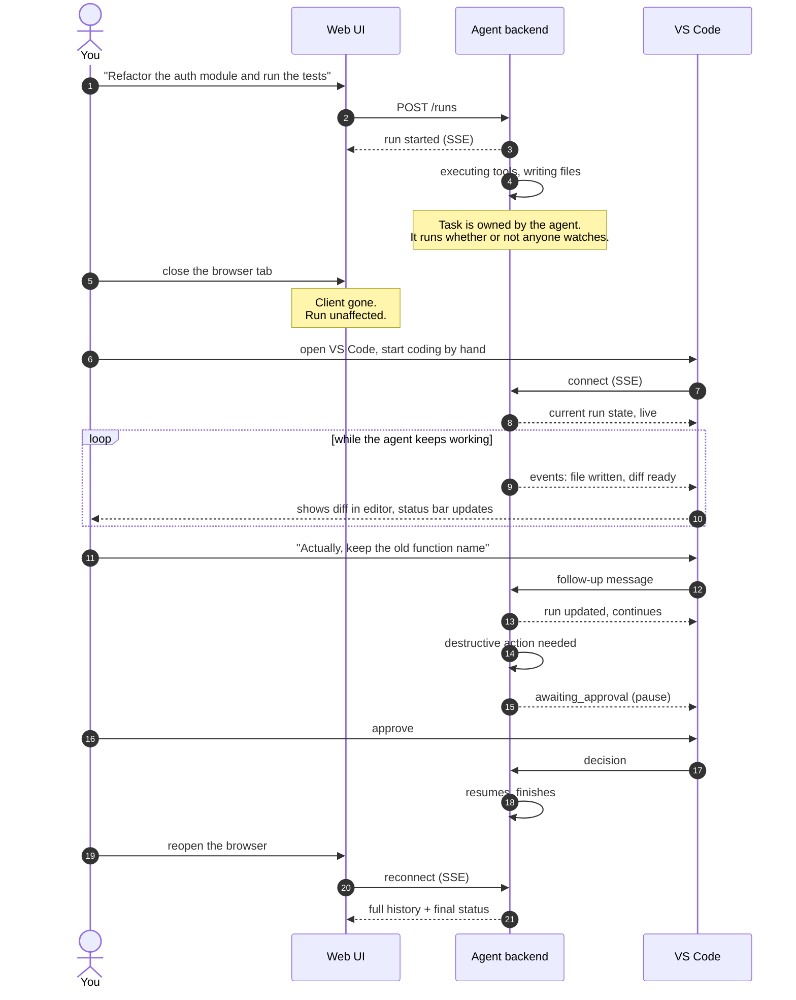

# Claudio Architecture — One Agent, Two Clients

Claudio is **one long-lived agent** with **two independent client surfaces**.

The **Agent** is the only component that owns state and guarantees that running
work stays consistent. The **Web UI** and the **VS Code extension** are clients:
they display what the agent is doing and let a human steer it. Either client can
be closed, crash, or be restarted at any moment, and the agent keeps running
exactly as before. When a client comes back, it reconnects and catches up.

This is the property that makes the whole system usable: you can start a long task
on the agent machine, close your laptop's browser tab, open VS Code, keep coding,
and later reopen the Web UI to see the task still running — and ask for changes.



---

## The core idea: the agent persists, the clients observe

| | Agent (backend) | Web UI | VS Code extension |
|---|---|---|---|
| **Role** | Executes and guarantees | Displays and steers | Displays and steers |
| **Lifetime** | Long-lived daemon | Short-lived, comes and goes | Short-lived, comes and goes |
| **Owns state** | Yes — the single source of truth | No — a cached view | No — a cached view |
| **Can run work without a client** | Yes | No | No |
| **Talks to the agent via** | — | HTTP + SSE | HTTP + SSE |
| **Restart breaks a running task?** | — | No | No |

Everything flows from one rule:

> **A client is a window onto the agent, not a participant in the task.**
> Closing the window does not stop what is happening behind it.

---

## 1. The Agent (backend)

The agent is a daemon (`claudio-backend`, launched with `./backend-start.sh`,
default `http://127.0.0.1:8100`). It is the **only component with authority**.

### What it guarantees

**Process consistency.** Every unit of work is a *run* with an explicit lifecycle
(`pending → running → awaiting_approval → completed | failed | cancelled`). The
transition is owned by the agent's `RunManager`, never by a client. A run does
not care whether anyone is watching.

**Durable state.** Runs, messages, costs, approvals and settings live in SQLite
(`claudio-core/db.py`). A client that reconnects reads the same truth the agent
is acting on. Nothing important exists only in a browser's memory.

**Single writer.** Tool calls, file writes and commands are executed by the agent,
in one process, in a defined order. Two clients cannot corrupt each other's view
because neither of them writes directly — they *request*, the agent *does*.

**Approvals are agent-side.** A destructive action pauses the run and waits for a
decision. That decision can come from the Web UI, from VS Code, or not at all.
The pause is a property of the run, not of whichever window happens to be open.

**Scheduled and autonomous work.** Cron-style jobs and the self-maintenance loop
run on the agent's own schedule, entirely independent of client presence.

### What it exposes

A versioned HTTP API (`/api/v1`) plus a Server-Sent Events stream of typed
events. The event protocol is frozen in `claudio_core/events.py` — it is the
contract between the agent and *any* client, present or future. Clients never
reach into agent internals.

### What's inside the agent

The agent is not a monolith. Five cooperating parts, each with one job, make up
everything the clients can see and drive:

| Component | Lives in | Responsibility |
|---|---|---|
| **RunManager** | `runs/manager.py` | Owns every run's lifecycle — create, start, pause, resume, complete, cancel. The single authority over run state. |
| **Tool execution** | `engine/` + `claudio_core/tools/` | Runs the actual tools — file edits, shell commands, web fetch/search — in order, in one process, recording every result. |
| **Approvals** | `api/approvals.py` + engine pause/resume | Gates destructive actions. A run pauses here until a decision arrives from any client — or never. |
| **Scheduled jobs** | `autonomous/scheduler.py`, `task_scheduler.py` | Cron-style tasks that fire on the agent's own clock, independent of any client being connected. |
| **Self-maintenance loop** | `autonomous/` (health, maintenance, recovery, fixer) + self-improvement (`consolidation.py`, `promotion.py`) | Watches the system, runs upkeep, recovers from failures, and turns recurring learnings into skills. |

Everything a client observes flows through these five components. The clients run
none of them — they *request*, and the agent's components *act*. This is the
same single-writer rule from above, seen from the inside.

---

## 2. The Web UI (frontend)

A React SPA (`claudio-frontend`, Vite dev server on `:5173`, or a static
`dist/`). It is a **remote control with a screen**.

**It shows.** Live run status, streaming output, tool calls, approvals waiting,
cost and context usage, scheduled tasks, memory. All of it arrives over SSE; the
UI renders what the agent already decided.

**It steers.** Send a new message, stop a run, approve or deny a pending action,
change settings, queue a follow-up while a task is still running. Every one of
those is an HTTP request to the agent — the UI never performs the work itself.

**It is disposable.** Close the tab mid-run: the agent keeps going. Reopen it
later: it re-subscribes to the event stream and re-renders current state. If the
SSE connection drops, the UI reconnects on its own; the gap in the stream is
filled from the agent's stored history, not lost.

Because the Web UI has no local state of consequence, it can be opened from a
different machine than the one the agent runs on. That is what makes remote
control of a long task possible.

---

## 3. The VS Code extension

The third surface (`claudio-vscode`, design brief in
[doc/vscode-extension-plan.md](./vscode-extension-plan.md)). Same API, same
event protocol, different ergonomics: it lives inside the editor and binds the
agent to the folder you have open.

**It shows.** The agent's edits appear as diffs in the editor; created files show
up in the explorer; a status-bar item reports run state, cost and context usage
at a glance while you code.

**It steers.** Chat, selection-as-context, approve/deny on the keyboard, stop a
run, edit the proposal yourself in the editor and hand it back.

**It is disposable too.** Reload the window, close VS Code, switch branches —
the agent's runs are unaffected. On restart the extension re-establishes its
connection and re-syncs.

The extension is *not* a second backend. It changes nothing about how the agent
executes; it only changes how close the controls are to the code you are editing.

---

## 4. Component diagram



Solid arrows = commands the client issues. Dotted arrows = the event stream the
agent pushes. Both clients are peers: identical access, no privilege, no local
authority.

### Scenario: long task running, both clients come and go



The two clients never talk to each other. They are two windows onto the same
process, and neither one's lifetime affects it.

---

## 5. Disconnect and reconnect semantics

| Event | What the agent does | What the returning client does |
|---|---|---|
| Client closes / crashes | Keeps running the task; keeps recording events | — |
| Network drops mid-stream | Task unaffected; events stay in history | Auto-reconnects, re-reads history, re-renders |
| Client opens while a task runs | Serves current state immediately | Shows the run in progress, controls live |
| Agent restarts | Recovers persisted runs from SQLite | Reconnects, sees recovered state |
| Both clients closed for hours | Scheduled jobs and runs continue | First client back sees the whole picture |

The failure mode this design removes: *a task dying because the window it was
launched from went away.*

---

## 6. Invariants

1. **The agent is the only writer.** Clients request; the agent executes.
2. **State lives in the agent, not in the client.** Any client can be destroyed
   without losing anything the agent needs.
3. **The event protocol is the contract.** Frozen in `claudio_core/events.py`;
   neither side changes it unilaterally.
4. **Clients are interchangeable.** The same task can be started from the Web UI
   and steered from VS Code, or the other way round.
5. **A client is never required for progress.** If no client is connected, the
   agent still finishes, still records, still runs its schedule.

---

## 7. Summary

```
        Web UI  ──┐                    ┌──  VS Code
   (view + control)  │   commands / events   │  (view + control)
                  └────────►  AGENT  ◄───────┘
                     owns runs, state, approvals, schedule
                     long-lived, survives every client restart
```

Two disposable windows, one durable process. Start work from wherever, watch it
from wherever, change your mind from wherever — the agent just keeps going.
