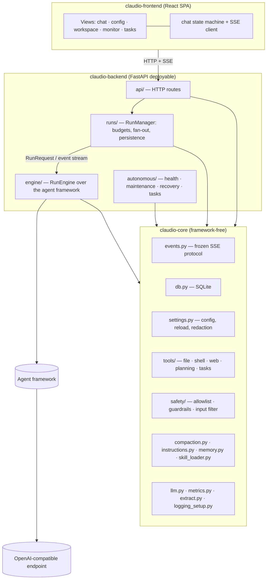
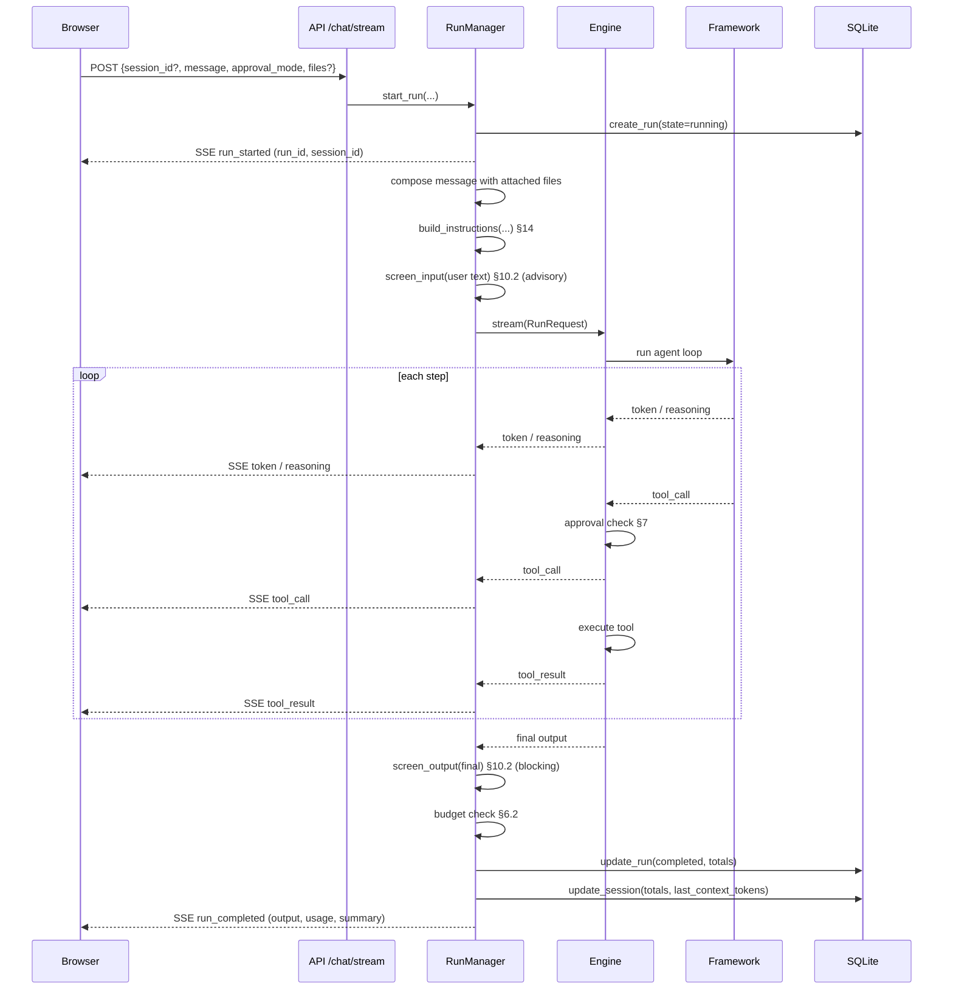
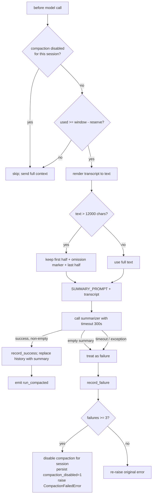
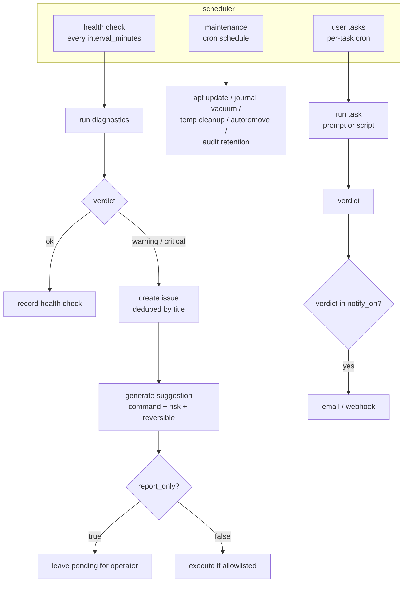
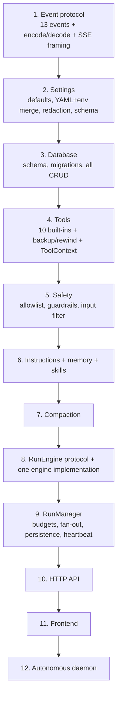

# Claudio — Rebuild Specification

A complete, self-contained specification of Claudio: every subsystem, every
contract, every default, and the flow diagrams that show how the pieces move.
Written so that someone who has never seen the codebase can rebuild it from
nothing. Where a number or a default matters, it is stated here rather than left
to discovery.

This document describes **what the system does**. It is deliberately independent
of any particular agent framework: the framework sits behind one interface and is
replaceable. Everything else — storage, settings, tools, safety, the wire
protocol — is framework-free and is the actual product.

---

## 0. How to read this

| If you want to... | Read |
|---|---|
| Understand the whole system in one pass | §1–§3, then the diagrams in §6, §11 |
| Rebuild storage | §4 |
| Rebuild config | §5 |
| Rebuild the chat path | §6, §7, §8, §12, §13 |
| Rebuild the tool layer | §9, §10 |
| Rebuild the daemon | §11 |
| Know what to build first | §17 |

Terms used throughout:

- **core** — the framework-free domain package. No agent framework, no HTTP.
- **engine** — the one component that talks to an agent framework. Implements the
  `RunEngine` protocol (§3.4).
- **run** — one agent turn: user message in, agent works with tools, final answer
  out. Has a `run_id`, is persisted, can be paused and resumed.
- **session** — a conversation. Has a `session_id`, holds an ordered transcript
  and cumulative totals.
- **operator** — the human at the frontend.

---

## 1. What Claudio is

A local-first agentic assistant. A chat surface drives real tools inside a
workspace directory: read and write files, run shell commands, fetch the web.
Destructive actions pause for human approval. Every run is tracked for cost,
tokens, and turns. Long conversations are compacted automatically. A separate
daemon performs scheduled health checks, maintenance, and recovery.

Three properties define the design:

1. **Local-first.** The model is an OpenAI-compatible endpoint the operator runs
   (or points at). No third-party service is load-bearing.
2. **Human-in-the-loop by default.** Writes, edits, and shell commands require
   approval unless the operator explicitly turns that off.
3. **The protocol is the product.** The UI never sees the framework. It sees a
   stream of 13 typed events (§3). That stream is frozen and is the contract both
   sides build against.

---

## 2. System architecture



**Two hard boundaries**, each enforced mechanically by an import-linter contract,
not by convention:

| Boundary | Rule |
|---|---|
| core is framework-free | core may not import any agent framework or LLM SDK package |
| only the engine knows about the framework | `api/` and `runs/` may not import the framework |

If either contract breaks, the build fails. This is the single most important
structural fact about the system: it is what makes the framework replaceable.

**Dependency direction.** core depends on nothing above it. The engine depends on
core plus the framework. `runs/` depends on core and on the engine *through the
protocol only*. `api/` depends on core and `runs/`. The daemon depends on core.
The frontend depends on nothing but the wire contract.

---

## 3. The frozen event protocol

Everything the UI needs travels as a stream of typed events over Server-Sent
Events. This protocol is **frozen**: neither side may change it unilaterally.

### 3.1 The 13 events

| Event | Payload | Meaning |
|---|---|---|
| `run_started` | `run_id`, `session_id` | Emitted once, by the RunManager, before the engine starts |
| `token` | `text` | Incremental assistant text |
| `reasoning` | `text` | Incremental reasoning/chain-of-thought text |
| `tool_call` | `call_id`, `name`, `arguments` (JSON **string**) | Agent invoked a tool |
| `tool_result` | `call_id`, `output` (string), `is_error` | Tool returned |
| `approval_required` | `approval_id`, `tool`, `arguments` (JSON string), `reason` | Run paused for human decision |
| `usage` | `input_tokens`, `output_tokens`, `cost_usd` | Token/cost snapshot |
| `context_usage` | see §8.1 | Context window occupancy |
| `run_completed` | `output`, `usage`, `summary` | Success terminal event |
| `run_failed` | `code`, `message`, `retryable` | Failure terminal event |
| `run_restarting` | `reason` | Current attempt discarded, retrying |
| `run_compacted` | `summary`, `freed_tokens` | Mid-run compaction finished |
| `heartbeat` | `{}` | Liveness keepalive, every 15s |

### 3.2 Wire format

Each SSE frame:

```
id: <seq>
event: <event_name>
data: <json>

```

- `seq` is a per-run monotonically increasing integer. It is the resume cursor.
- `data` is a single JSON object, never an array, never empty.

### 3.3 Invariants that must be enforced on encode

These are not stylistic. Violating them breaks the frontend silently.

1. `tool_call.arguments` **must** be a JSON string, not an object.
2. `approval_required.arguments` **must** be a JSON string, not an object.
3. `tool_result.output` **must** be a string. If a tool returns a structured
   value, serialize it to a string first.
4. `run_completed` is emitted **exactly once** per successful run.
5. `run_started` is emitted by the RunManager, **never** by the engine.

### 3.4 The `RunEngine` protocol

The engine is defined by three methods. Nothing else.

```
RunEngine:
    async stream(request: RunRequest) -> AsyncIterator[Event]
    async resume(request: RunRequest, state: Any) -> AsyncIterator[Event]
    async cancel(run_id: str) -> None
```

Supporting data types:

**`ModelSpec`** — a plain description of a model, not a client object.
| Field | Default |
|---|---|
| `model` | (required) |
| `base_url` | `None` |
| `api_key` | `"local"` |
| `temperature` | `0.2` |
| `max_tokens` | `4096` |
| `timeout_seconds` | `120.0` |
| `fallback_model` | `None` |

**`ToolPolicy`** — `enabled: tuple`, `disabled: tuple`,
`approval_mode: "on_request"`, `strict_mode: bool = False`.

**`RunRequest`** — everything the engine needs, pre-assembled by core.
| Field | Notes |
|---|---|
| `run_id`, `session_id` | identity |
| `workspace` | `Path`, the working directory |
| `instructions` | fully assembled system prompt (§14); the engine must **not** append to it |
| `user_input` | the user's message |
| `model` | `ModelSpec` |
| `tools` | `ToolPolicy` |
| `max_turns` | `30` |
| `history` | list of OpenAI-style message dicts; empty on first run, populated after compaction |
| `metadata` | free dict |

**`RunOutcome`** — mutable result: `final_output`, `input_tokens`,
`output_tokens`, `cost_usd`, `turns_used`, `raw`. Failure is signalled by
**raising**, not by this type.

**`EngineError`** — `code: str`, `message: str`, `retryable: bool = False`.
Maps directly onto the `run_failed` event.

An event is terminal when its name is `run_completed` or `run_failed`.

---

## 4. Data model (SQLite)

Single SQLite file, async access, `row_factory = Row`. All tables are namespaced
`claudio_` because the file is shared with the agent framework's own session
tables. All timestamps are ISO-8601 UTC strings. Every write commits immediately.

### 4.1 `claudio_sessions`

One row per conversation.

| Column | Type | Default |
|---|---|---|
| `id` | TEXT | PK |
| `title` | TEXT | `''` |
| `created_at` | TEXT | required |
| `updated_at` | TEXT | required |
| `message_count` | INTEGER | `0` |
| `total_cost_usd` | REAL | `0` |
| `total_input_tokens` | INTEGER | `0` |
| `total_output_tokens` | INTEGER | `0` |
| `last_context_tokens` | INTEGER | `0` |
| `compaction_disabled` | INTEGER | `0` |
| `turns_since_todo` | INTEGER | `0` |
| `todos` | TEXT | `'[]'` |

`compaction_disabled` is the persisted circuit-breaker state (§8.4). `todos` is
the last `todo_write` payload, JSON.

### 4.2 `claudio_config_history`

| Column | Type | Notes |
|---|---|---|
| `id` | INTEGER | PK autoincrement; doubles as version number |
| `saved_at` | TEXT | |
| `changed_keys` | TEXT | JSON array of dotted keys |
| `config_json` | TEXT | full config snapshot |

Trimmed to the **last 20** versions on every insert.

### 4.3 `claudio_approvals`

| Column | Type | Default |
|---|---|---|
| `id` | TEXT | PK, uuid4 |
| `run_id` | TEXT | required |
| `session_id` | TEXT | required |
| `tool_name` | TEXT | required |
| `call_id` | TEXT | required |
| `arguments` | TEXT | `'{}'` JSON |
| `reason` | TEXT | `''` |
| `state` | TEXT | `'pending'` |
| `requested_at` | TEXT | required |
| `resolved_at` | TEXT | nullable |
| `decision` | TEXT | nullable — `approve` / `deny` |
| `decision_reason` | TEXT | nullable |

### 4.4 `claudio_runs`

| Column | Type | Default |
|---|---|---|
| `id` | TEXT | PK |
| `session_id` | TEXT | required |
| `state` | TEXT | required |
| `started_at` | TEXT | required |
| `finished_at` | TEXT | nullable |
| `turns_used` | INTEGER | `0` |
| `cost_usd` | REAL | `0` |
| `input_tokens` | INTEGER | `0` |
| `output_tokens` | INTEGER | `0` |
| `final_output` | TEXT | nullable |
| `error_code` | TEXT | nullable |
| `error_message` | TEXT | nullable |
| `resume_state_json` | TEXT | nullable |

Indexed on `session_id`.

### 4.5 `claudio_health_checks`

`id` (PK), `created_at`, `verdict`, `summary`, `details_json` (JSON array),
`duration_ms`, `source` (default `'scheduled'`). Indexed on `created_at DESC`.

### 4.6 `claudio_issues`

`id` (PK), `created_at`, `source` (default `'health'`), `severity`, `title`,
`detail`, `status` (default `'open'`), `resolved_at`, `resolution`.
Indexed on `status`.

### 4.7 `claudio_suggestions`

`id` (PK), `issue_id` (nullable), `created_at`, `command`, `explanation`,
`risk` (default `'low'`), `reversible` (default `1`), `status`
(default `'pending'`), `executed_at`, `exit_code`, `output`.
Indexed on `issue_id`.

### 4.8 `claudio_audit`

`id` (PK), `created_at`, `actor` (default `'operator'`), `action`, `command`,
`exit_code`, `detail`.

### 4.9 `claudio_tasks`

| Column | Type | Default |
|---|---|---|
| `key` | TEXT | PK |
| `name` | TEXT | required |
| `type` | TEXT | `'prompt'` |
| `prompt` | TEXT | `''` |
| `script` | TEXT | nullable |
| `schedule` | TEXT | required (cron) |
| `approval_mode` | TEXT | `'off'` |
| `report_only` | INTEGER | `1` |
| `notify_on` | TEXT | `'["warning","critical","failure"]'` |
| `enabled` | INTEGER | `1` |
| `last_run_at` | TEXT | nullable |
| `next_run_at` | TEXT | nullable |
| `last_verdict` | TEXT | nullable |
| `created_at` | TEXT | required |
| `updated_at` | TEXT | required |

### 4.10 `claudio_task_runs`

`id` (PK), `task_key`, `started_at`, `finished_at`, `verdict`, `summary`,
`output`, `exit_code`, `trigger` (default `'scheduled'`).
Indexed on `(task_key, id DESC)`.

### 4.11 Migration

Migrations are idempotent `PRAGMA table_info` checks that add missing columns:
`claudio_runs.resume_state_json`, `claudio_sessions.last_context_tokens`,
`claudio_sessions.todos`, `claudio_tasks.type`, `claudio_tasks.script`. One
table is rebuilt (create-new → copy → drop → rename) when `issue_id` is still
`NOT NULL`, because it must be nullable.

**Rebuild note:** run migrations at startup, before any read. They must be safe
to run repeatedly.

---

## 5. Configuration

### 5.1 Model and merge order

Config is a tree of validated model objects. Merge order is:

```
built-in defaults  <  YAML file  <  environment variables
```

The live file is `config/config.yaml`. The last 20 versions are kept in
`claudio_config_history`.

### 5.2 Environment overrides

Prefix `CLAUDIO__`, separator `__`. A key must have **exactly two parts** after
the prefix — `SECTION__KEY` — or it is skipped. The value is parsed as JSON, so
lists, numbers, booleans and null all work; on parse failure the raw string is
used.

```bash
export CLAUDIO__LLM__BASE_URL="http://localhost:8081/v1"
export CLAUDIO__SERVER__PORT="8100"
export CLAUDIO__AGENT__SKILLS_ENABLED="false"
```

### 5.3 Complete field list with defaults

**`server`**
| Field | Default |
|---|---|
| `host` | `"127.0.0.1"` |
| `port` | `8100` |
| `auth_token` | `"dev-token-change-me"` |
| `cors_origins` | `["http://localhost:5173"]` |
| `expose_raw_config` | `False` |

**`llm`**
| Field | Default |
|---|---|
| `provider` | `"openai"` |
| `model` | (a local model name) |
| `api_key` | `"local"` |
| `base_url` | `"http://127.0.0.1:1234/v1"` |
| `temperature` | `0.2` |
| `max_tokens` | `16384` |
| `fallback_model` | `None` |
| `timeout_seconds` | `300` |
| `retry_attempts` | `3` |
| `price_input_per_mtok` | `0.0` |
| `price_output_per_mtok` | `0.0` |

**`agent`**
| Field | Default | Notes |
|---|---|---|
| `name` | `"claudio"` | |
| `instructions_file` | `"instructions.md"` | |
| `instructions` | `None` | overrides file if set |
| `max_turns` | `50` | |
| `max_budget_usd` | `5.0` | |
| `approval_mode` | `"on_request"` | `off` \| `on_request` \| `always` |
| `workspace_dir` | `"./data/workspace"` | |
| `context_window` | `32768` | |
| `compaction_reserve` | `8192` | |
| `compaction_timeout_seconds` | `300` | separate, larger budget so a slow summarizer does not trip the breaker |
| `max_output_chars` | `8000` | per-tool-output clip |
| `strict_tools` | `False` | |
| `skills_enabled` | `True` | |
| `skills_dir` | `"./skills"` | |
| `tools.enabled` | `[]` | |
| `tools.disabled` | `[]` | |
| `subagents` | `{}` | map of name → `SubagentConfig` |

**`SubagentConfig`** — `description=""`, `instructions_file=None`,
`instructions=None`, `tools=[]`, `max_turns=30`.

**`mcp.servers[]`** — each `MCPServerEntry`: `id`, `transport`
(`stdio` \| `sse` \| `streamable_http`), `command=[]`, `url=None`,
`enabled=True`.

**`monitoring`** — `log_level="INFO"`, `log_retention_days=7`,
`metrics_snapshot_interval_seconds=5`.

**`autonomous.notification`** — `enabled=False`, `email{...}`, `webhook{...}`.
Email: `enabled=False`, `smtp_host=""`, `smtp_port=587`, `username=""`,
`password=""`, `from_addr=""`, `to_addr=""`, `use_tls=True`.
Webhook: `enabled=False`, `url=""`.

**`autonomous.health_check`** — `enabled=True`, `interval_minutes=10`,
`disk_warn_percent=85.0`, `disk_crit_percent=95.0`, `mem_crit_percent=95.0`,
`swap_warn_percent=80.0`, `load_warn_factor=1.0`, `load_crit_factor=2.0`,
`backup_path=""` (empty disables the backup-freshness check),
`backup_max_age_hours=26.0`, `script=""` (non-empty replaces the built-in
diagnostics entirely; exit 0 = ok, non-zero = critical).

**`autonomous.maintenance`** — `enabled=False`, `schedule="0 3 * * *"` (cron,
UTC), `vacuum_size="200M"`, `temp_dirs=["/tmp","/var/tmp"]`,
`audit_retention_days=90`, `apt_update=True`, `vacuum_logs=True`,
`temp_cleanup=True`, `autoremove=True`, `full_upgrade=False`,
`docker_prune=False`, `script=""`.

**`autonomous.recovery`** — `enabled=False`, `expected_services=[]`,
`restart_allowlist=[]`.

**`autonomous`** top level — `enabled=False`, `report_only=True`, plus the four
sections above, plus `command_allowlist=None` (when set, **replaces** the
built-in allowlist rather than extending it).

### 5.4 Secret handling

Three paths are treated as secrets: `llm.api_key`, `server.auth_token`,
`autonomous.notification.email.password`.

When config is sent to the frontend, secrets are replaced with `***`. When the
frontend sends config back, a `***` is interpreted as **"unchanged"**, never as
"set the secret to `***`", and the live value is restored before saving. This
round-trip rule must be applied on **every** write path, including restore from
history.

### 5.5 Restart semantics

`changed_keys(old, new)` produces a dotted diff. `restart_required_for(changed)`
returns:
- `"backend"` if any changed key is `server.host` or `server.port`
- `"agent"` if any changed key's top section is `mcp`

The API reports this in its response; it does not perform the restart.

### 5.6 Write discipline

Config writes are atomic: write to a temp file in the same directory, then
`os.replace`. On failure the temp file is unlinked. Never write in place.

---

## 6. Chat run lifecycle

This is the central flow of the product.



### 6.1 What the RunManager owns

The RunManager is the orchestrator between HTTP and the engine. It owns:

- creating and updating the `claudio_runs` row
- emitting `run_started` (the engine must not)
- fan-out: one run, many subscribers (multiple browser tabs)
- budget enforcement (§6.2)
- persisting totals to the session row on completion
- the event sequence numbers used for resume
- heartbeats every 15 seconds

### 6.2 Budget enforcement

Two limits apply during a run:

| Limit | Config | On breach |
|---|---|---|
| Turns | `agent.max_turns` (50) | run ends; reported as completed-with-limit |
| Cost | `agent.max_budget_usd` (5.0) | run is stopped and reported failed |

Cost is computed from token counts against `llm.price_input_per_mtok` /
`price_output_per_mtok`. With the default zero prices, the cost budget is inert;
it becomes meaningful only when prices are configured.

### 6.3 Failure and retry

When the engine raises `EngineError`:
- if `retryable` → emit `run_restarting`, discard the partial attempt, retry
- if not retryable → emit `run_failed` with the code and message

`run_restarting` tells the frontend to **roll the transcript back** to the last
user message (§13.3), because the retry re-streams from scratch.

### 6.4 Interrupted runs at boot

On startup, any run still in state `running` is marked `failed` with
`error_code = "backend_restarted"`. This is done once, before serving traffic,
because a run that outlived its process is not actually running.

---

## 7. Approval: pause and resume

The approval gate is the core safety mechanism. It is **not** text matching — it
is a hard pause before a destructive tool executes.

### 7.1 Which tools pause

The decision is **static**, made from tool metadata, never from arguments:

| `approval_mode` | Pauses for |
|---|---|
| `off` | nothing |
| `always` | every tool |
| `on_request` (default) | tools marked `is_destructive` |

Under the default `on_request`, the gated tools are:
**`write_file`, `edit_file`, `rewind_files`, `run_command`**.

**Why static and not argument-dependent.** A callable policy invites the framework
to inspect arguments and prove they were unchanged after validation. Local models
frequently omit optional parameters; that proof then fails and the framework
demands approval for *every* call, including read-only ones. A static boolean
sidesteps the whole class of problem. Out-of-workspace file access is enforced
inside the file tools themselves (§9.3), not here.

### 7.2 The pause/resume round trip

```mermaid
sequenceDiagram
    participant E as Engine
    participant M as RunManager
    participant D as SQLite
    participant B as Browser

    E->>E: destructive tool requested
    E->>M: approval required
    M->>D: create_approval(state=pending)
    M->>D: persist resume_state_json
    M-->>B: SSE approval_required (approval_id, tool, arguments, reason)
    Note over E,B: run is PAUSED, not finished. streaming stays true.
    B->>M: POST /approvals/{id} {decision: approve|deny}
    M->>D: resolve_approval(decision, resolved_at)
    alt approved
        M->>E: resume(request, state)
        E->>E: execute the tool
        E-->>M: tool_result
        M-->>B: SSE tool_result, continue streaming
    else denied
        M->>E: resume(request, state) with denial
        E-->>M: synthetic tool_result: denied
        M-->>B: continue; agent adapts
    end
```

### 7.3 Rules that matter

1. **A pause is not a stop.** The frontend must keep `streaming = true` while an
   approval is pending, or the Stop control disappears and the turn looks dead.
2. **Resume state must survive process death.** The checkpoint is serialized to
   `claudio_runs.resume_state_json` before the `approval_required` event is
   emitted, so a different process can resume it.
3. **A denial is not an error.** The agent receives a synthetic "denied" tool
   result and is expected to adapt, not crash.
4. **Approvals are persisted**, so a reload can show pending approvals and the
   audit trail is complete.

---

## 8. Context compaction

Long conversations exceed the model's context window. Compaction summarizes old
turns into a compact summary and continues.

### 8.1 The context budget

```
window  = agent.context_window            (32768)
reserve = agent.compaction_reserve        (8192)
usable  = max(1, window - reserve)      → 24576
free    = max(0, usable - used_tokens)
percent = min(100, used / usable * 100)
```

The `context_usage` payload carries: `used_tokens`, `context_window`,
`usable_tokens`, `free_tokens`, `percent_used`, `compact_threshold` (= usable),
`source`, `auto_disabled`.

`source` is one of `"model"` (reported by the model), `"estimate"` (computed
locally), `"stored"` (read from the session row).

### 8.2 When compaction fires

```
should_compact = used_tokens >= context_window - reserve
```

i.e. at 24576 tokens with the defaults. Compaction is checked **before** each
model call, not only when the call fails.

### 8.3 The compaction flow



### 8.4 The circuit breaker

Compaction can fail repeatedly — a slow or broken summarizer would otherwise
stall every turn forever. So:

- `CIRCUIT_BREAKER_THRESHOLD = 3` consecutive failures
- on trip: compaction is disabled for that session, persisted to
  `claudio_sessions.compaction_disabled`
- on startup, disabled sessions are restored from the DB
- `enable(session_id)` clears both the disabled flag and the failure count

Key constants:
| Constant | Value | Purpose |
|---|---|---|
| `CIRCUIT_BREAKER_THRESHOLD` | 3 | consecutive failures that trip |
| `DEFAULT_COMPACTION_TIMEOUT_SECONDS` | 300.0 | summarizer timeout |
| `MAX_SUMMARY_INPUT_CHARS` | 12000 | cap on transcript handed to the summarizer |

The summary prompt requires a structured summary with six numbered sections and a
mandatory trailing `PROGRESS: DONE: ... TODO: ...` checklist. The checklist is
what lets the agent continue coherently after compaction.

### 8.5 Mid-run vs pre-run

Compaction can happen **mid-run** (emitting `run_compacted`, transcript
preserved) and **between runs** (manual compact endpoint). The distinction
matters to the frontend: `run_compacted` does **not** roll back the visible
transcript, whereas `run_restarting` does.

---

## 9. Tools

Ten built-in tools plus three skill tools. Every tool is a plain async function
taking a `ToolContext` as its first argument. Every tool returns a dict of the
shape `{"ok": bool, ...}`.

### 9.1 Inventory

| Tool | Read-only | Destructive | Path arg | Behavior |
|---|---|---|---|---|
| `read_file` | ✓ | | `path` | Read text file; optional 1-based `start_line`/`end_line`; numbered output; clipped to `max_output_chars` |
| `write_file` | | ✓ | `path` | Create/overwrite; `append` param; backs up previous content; sets `deliverable_written=True`, `reads_since_write=0` |
| `edit_file` | | ✓ | `path` | Exact-string replace; `replace_all` param; requires unique match unless `replace_all`; backs up |
| `list_dir` | ✓ | | `path` | List entries `{name,type,size}`, max 500 |
| `rewind_files` | | ✓ | | Restore file(s) from last backup; `path=None` rewinds all tracked |
| `run_command` | | ✓ | | Shell command in workspace, `timeout=60.0`, returns `exit_code`/`stdout`/`stderr` clipped |
| `web_fetch` | ✓ | | | GET URL, HTML→text strip, clip to `max_output_chars` |
| `web_search` | ✓ | | | `query`, `max_results=5`; tries Bing then DuckDuckGo HTML; first with results wins |
| `todo_write` | ✓ | | | Replace todo list `[{content,status}]`, status ∈ pending/in_progress/done; permissive coercion of malformed input; resets `turns_since_todo`; persists `todos` |
| `create_scheduled_task` | | | | Create cron task from chat; created **disabled + report_only**; validates cron; unique slugified key; audits |

Plus three skill tools — `list_skills`, `load_skill`, `read_skill_resource` —
built dynamically by the skill loader. They are read-only and **never** require
approval.

`create_scheduled_task` is deliberately neither read-only nor destructive:
creating a task row is not a system mutation, because the task is created
disabled and report-only and only acts once the operator enables it.

### 9.2 Tool selection

`select_tool_names(enabled, disabled)` returns `[n for n in enabled if n is
registered and n not in disabled]`. Unregistered names are dropped **silently**
— the caller logs the difference so a typo in config is visible without breaking
the run.

### 9.3 File backup and rewind

Before every `write_file` or `edit_file`, the previous content is copied to a
per-session history directory:

```
<workspace>/../file-history/<session_id>/
    index.json          # absolute path -> [backup filenames]
    somefile.py@v1
    somefile.py@v2
```

`rewind_files` restores from these backups. This is the undo mechanism for the
agent's file mutations and is the reason `rewind_files` is destructive.

### 9.4 Output clipping

Every tool output is clipped to `agent.max_output_chars` (8000). This prevents a
single `cat` of a large file from blowing the context window.

---

## 10. Safety layers

Safety is layered. Each layer sits at a specific point in the request/response
path and has a specific, non-overlapping job.

```mermaid
flowchart LR
    U["user message"] --> L1["screen_input<br/>advisory, never blocks"]
    L1 --> L2["instruction assembly"]
    L2 --> L3["input filter: truncate + repair<br/>before every model call"]
    L3 --> L4["approval gate<br/>before destructive tools"]
    L4 --> L5["screen_tool_arguments<br/>allowlist check"]
    L5 --> L6["tool executes"]
    L6 --> L7["screen_output<br/>blocks on secrets / empty"]
    L7 --> OUT["to user"]
```



### 10.1 Layer summary

| Layer | Where | Blocks? | Catches |
|---|---|---|---|
| `screen_input` | on user text, before the run | **No** — advisory | prompt-injection attempts (logged only) |
| input filter | before every model call | Yes (truncates) | context overflow, malformed tool-call JSON, orphaned calls |
| approval gate | before destructive tool execution | Yes (pauses) | unintended writes/commands |
| `screen_tool_arguments` | before shell-like tools | Yes | commands outside the allowlist |
| `screen_output` | on final model output | **Yes** | leaked credentials, empty output |
| command allowlist | daemon-initiated elevated commands | Yes | anything not explicitly permitted |

### 10.2 Why input screening is advisory and output screening blocks

This asymmetry is deliberate and stated in the code:

- **Input screening never blocks.** A false positive on user input would make the
  tool unusable, and the real defence against injection is the approval gate on
  destructive tools — not text matching. Injection patterns are logged so an
  operator can see them, nothing more.
- **Output screening does block.** A leaked API key or private key in model
  output is a concrete, irreversible harm, and the credential patterns are
  narrow enough that a false positive is rare and cheap to explain.

### 10.3 Guardrail details

**Injection patterns** (advisory): `ignore_previous_instructions`,
`disregard_system_prompt`, `pretend_to_be`, `reveal_system_prompt`,
`role_override`, `dan_jailbreak`.

**Secret patterns** (blocking): OpenAI key (`sk-...`), AWS access key
(`AKIA...`), private key block (`-----BEGIN ... PRIVATE KEY-----`), GitHub
token (`ghp_...`/`gho_`/etc.), Slack token (`xox...-`), generic bearer-shaped
(`40+ chars . 20+ chars`).

`redact_secrets(text)` replaces every secret-shaped substring with `[REDACTED]`
and is used where text must be kept (logs, persisted transcripts) but must not
contain the credential.

**Empty output trips.** An empty final answer is treated as a failure, not as
success, because the recovery loop treats a trip as "try again". Without this, a
model that produced nothing would be reported as having succeeded.

### 10.4 Command allowlist (daemon-initiated elevated commands)

The daemon runs privileged operations. The gate is a **positive** allowlist —
nothing runs unless it is explicitly listed.

Built-in allowlist:
```
/usr/bin/apt-get update
/usr/bin/apt-get -y autoremove
/usr/bin/apt-get -y upgrade
/usr/bin/journalctl --vacuum-size=200M
/usr/bin/docker system prune -f
/opt/claudio/scripts/cleanup_tmp.sh
```

This must mirror the OS sudoers file. `sudoers_snippet(config)` generates the
matching `claudio ALL=(root) NOPASSWD: ...` lines, including one
`/usr/bin/systemctl restart <unit>` per entry in
`autonomous.recovery.restart_allowlist`.

Validation rules:
- `validate_command_entry`: non-empty string, first token is an absolute path,
  contains **no** shell metacharacters from `; | & $ > < backtick \n \r`, and is
  not catastrophic.
- `is_catastrophic`: `rm -rf /`, `rm -fr /`, `mkfs.*`, `dd ... of=/dev/sdX`,
  fork bomb, `chmod -R 777 /`, `shutdown`, `init 0`, redirect onto raw disk.
- `is_allowed`: whitespace-normalized **exact** match against the effective
  allowlist. The command is matched **without** the `sudo` prefix; the caller
  adds `sudo -n`.
- `effective_allowlist`: `autonomous.command_allowlist` if set, else the
  built-in list. Setting it **replaces**, it does not extend.
- `validate_service_name`: regex `^[a-z0-9@._-]+$` **and** present in
  `autonomous.recovery.restart_allowlist`.
- `validate_vacuum_size`: regex `^\d+[MGT]$`.

### 10.5 The input filter (request sanitization)

Runs as a filter before **every** model call. Its philosophy is *prevent, don't
react*: keep the request within budget rather than handling overflow after the
fact.

Constants:
| Constant | Value | Note |
|---|---|---|
| `CHARS_PER_TOKEN` | 2.4 | deliberately over-counts |
| `IMAGE_TOKEN_ESTIMATE` | 1500 | per image |
| `MIN_KEEP_ITEMS` | 12 | never truncate below this |
| `_DEFAULT_MAX_WRITE_CHARS` | 8000 | per-write cap |

Behavior:
- `_truncate`: keep the system prompt plus the most recent items that fit;
  per-item cap `max(1200, budget * chars_per_token / 12)`; never begin with an
  orphaned `function_call_output`.
- `_repair_calls`: invalid JSON arguments → `{}` plus an explanatory output;
  dangling calls get a synthetic output. This keeps the message sequence valid.
- `TokenCalibrator`: exponential smoothing `0.7*old + 0.3*measured`, clamped to
  1.5–6.0, so the estimate converges to the model's real ratio.
- On any internal error the filter returns the input **unchanged** — a broken
  filter must not break the run.
- `format_tool_error`: for `tool_not_found`, lists available tools and suggests
  the closest match by string similarity.

---

## 11. Autonomous subsystem

A daemon that watches the machine and acts on a schedule. It has four functions:
health checking, maintenance, recovery, and user-defined scheduled tasks.



### 11.1 Health check

Runs every `interval_minutes` (default 10). Built-in diagnostics:

| Check | Warn | Critical |
|---|---|---|
| Disk usage | 85% | 95% |
| Memory | — | 95% |
| Swap | 80% | — |
| Load average | 1.0× cores | 2.0× cores |
| Backup freshness | older than 26h | — |

`backup_path` empty disables the backup check. `script` non-empty **replaces**
the built-in diagnostics entirely: exit 0 = ok, non-zero = critical.

Each run is recorded in `claudio_health_checks` with verdict, summary, details,
duration and source.

### 11.2 Issues and suggestions

A non-ok verdict creates an **issue**, deduplicated by title so a persistent
problem does not generate a new row every 10 minutes. Each issue can carry
**suggestions**: a command, an explanation, a `risk` level, and a `reversible`
flag. Suggestions are created `pending` and are executed only if the operator
approves **and** `report_only` is false **and** the command passes the allowlist.

### 11.3 Maintenance

Runs on its own cron schedule (default 03:00 UTC). Steps, each individually
toggleable:

| Step | Toggle | Default |
|---|---|---|
| `apt-get update` | `apt_update` | `True` |
| journal vacuum (`vacuum_size`) | `vacuum_logs` | `True` |
| temp dir cleanup (`temp_dirs`) | `temp_cleanup` | `True` |
| `apt-get -y autoremove` | `autoremove` | `True` |
| full upgrade | `full_upgrade` | `False` |
| docker prune | `docker_prune` | `False` |
| audit retention (`audit_retention_days`) | always | 90 days |
| custom `script` | if non-empty | — |

The cron expression is validated at config time with `croniter.is_valid`, and
`vacuum_size` with `validate_vacuum_size`.

### 11.4 Recovery

Recovery checks that expected services are running and restarts those that are
down, restricted to `restart_allowlist`.

> **Discrepancy to carry into the rebuild.** Recovery is registered in the task
> handler table (`HANDLERS`) alongside the other task types, but **nothing
> schedules it automatically**. It is reachable only through the manual API
> endpoint. A rebuild that wires recovery into the scheduler would be a behavior
> change, not a restoration — decide explicitly which is intended.

### 11.5 Notifications

Two channels, both disabled by default: SMTP email and a webhook. A task sends a
notification when its verdict appears in its `notify_on` list (default
`["warning","critical","failure"]`).

### 11.6 Global kill switches

| Switch | Default | Effect |
|---|---|---|
| `autonomous.enabled` | `False` | whole daemon off |
| `autonomous.report_only` | `True` | diagnose and report, never act |
| `autonomous.maintenance.enabled` | `False` | maintenance off |
| `autonomous.recovery.enabled` | `False` | recovery off |
| `autonomous.notification.enabled` | `False` | notifications off |

Note the defaults: the daemon ships **off**, and even when enabled it ships
**report-only**. An operator opts into action deliberately.

---

## 12. HTTP API surface

All routes under `/api/v1`. Auth via bearer token (`server.auth_token`) on every
route. Errors are JSON: `{error: {code, message, ...}}` with an appropriate HTTP
status.

### 12.1 Chat

| Method | Path | Purpose |
|---|---|---|
| POST | `/chat/stream` | Start a run; returns SSE stream. Body: `session_id?`, `message`, `approval_mode`, `files?` |
| POST | `/chat/runs/{run_id}/cancel` | Cancel a running run |
| GET | `/sessions/{sid}/active_run` | Is there a live run? Returns `active`, `run_id`, `last_seq` |
| GET | `/runs/{run_id}/stream` | Reattach to a live run from a sequence position |

### 12.2 Approvals

| Method | Path | Purpose |
|---|---|---|
| GET | `/approvals/pending` | List pending approvals |
| POST | `/approvals/{id}` | Resolve: `{decision: "approve" \| "deny"}` |

### 12.3 Sessions

| Method | Path | Purpose |
|---|---|---|
| GET | `/sessions` | List sessions |
| POST | `/sessions` | Create session |
| GET | `/sessions/{sid}` | Session row incl. `context_usage`, `todos` |
| DELETE | `/sessions/{sid}` | Delete session |
| GET | `/sessions/{sid}/messages` | Transcript |
| POST | `/sessions/{sid}/compact` | Manual compaction |

### 12.4 Config

| Method | Path | Purpose |
|---|---|---|
| GET | `/config` | Current config, secrets redacted, + `generation` |
| GET | `/config/schema` | JSON schema for form rendering |
| PUT | `/config` | Merge-patch; validates; writes atomically; returns `changed_keys`, `restart_required` |
| POST | `/config/validate` | Validate a candidate without saving |
| POST | `/config/llm/test` | Live connectivity test with unsaved settings |
| GET | `/config/history` | Last 20 versions |
| POST | `/config/restore` | Restore a version by id |
| GET | `/config/raw` | Unredacted — gated by `server.expose_raw_config`, off by default |

**PUT semantics.** The candidate is merged over current (deep merge), then
redacted placeholders are restored from live values, then validated, then
written atomically, then a history version is added, then the supervisor reloads.
Validation failure returns 422 and nothing is written.

**LLM test note.** The test uses `max_tokens=512`, not a tiny budget, because
reasoning models spend tokens on reasoning before emitting visible text; a small
budget empties `content` and the test falsely reports "no text".

### 12.5 Agent / tools

| Method | Path | Purpose |
|---|---|---|
| GET | `/agent/tools` | Tool inventory: name, is_read_only, is_destructive |

### 12.6 Autonomous

| Method | Path | Purpose |
|---|---|---|
| GET | `/autonomous/health` | Latest health check |
| GET | `/autonomous/health/history` | Past checks |
| POST | `/autonomous/health/run` | Run a health check now |
| GET | `/autonomous/issues` | List issues |
| PATCH | `/autonomous/issues/{id}` | Update issue status |
| GET | `/autonomous/suggestions` | List suggestions |
| POST | `/autonomous/suggestions/{id}/execute` | Execute a suggestion |
| POST | `/autonomous/recovery/run` | Run recovery now (the only trigger it has) |
| GET | `/autonomous/tasks` | List tasks |
| POST | `/autonomous/tasks` | Create task |
| PATCH | `/autonomous/tasks/{key}` | Update task |
| DELETE | `/autonomous/tasks/{key}` | Delete task |
| GET | `/autonomous/task_runs` | Task run history |

### 12.7 System

| Method | Path | Purpose |
|---|---|---|
| GET | `/healthz` | Liveness (no auth) — used by the start script |
| GET | `/metrics` | Metrics snapshot |

---

## 13. Frontend

React 18 + TypeScript + Vite + Tailwind 4. Five views: chat, config, workspace,
monitor, tasks. The frontend mirrors the wire contract in its own type
definitions; the two must stay in sync.

### 13.1 Chat state

```
items:              ordered transcript items
streaming:          a run is in flight
runId:              current run id
usage:              last usage snapshot
error:              last error string
pendingApproval:    approval awaiting decision
plan:               latest todo_write plan
context:            latest context_usage
lastUserText:       last user message (for retry)
reconnecting:       SSE dropped but run alive
compactedCount:     increments per run_compacted (drives a toast)
```

Item kinds: `user`, `assistant`, `reasoning`, `tool`, `approval`, `turn_status`.

### 13.2 Event → state mapping

| Event | State effect |
|---|---|
| `run_started` | set `runId`, `streaming=true`, clear error |
| `token` | append to last `assistant` item, or create one |
| `reasoning` | append to last `reasoning` item, or create one |
| `tool_call` | push a `tool` item, `pending=true` |
| `tool_result` | close the matching `tool` item by `call_id`; if it was `todo_write`, refresh `plan` |
| `approval_required` | push `approval` item; **keep `streaming=true`** |
| `usage` | set `usage` |
| `context_usage` | set `context` |
| `run_completed` | `streaming=false`, push `turn_status(completed)` |
| `run_failed` | `streaming=false`, set error, push `turn_status(failed\|interrupted)` |
| `run_restarting` | **roll back** items to the last user message; clear `plan` |
| `run_compacted` | clear `reconnecting`; bump `compactedCount` |
| `heartbeat` | no-op |

`run_failed` with code `cancelled` or `connection_error` maps to
`interrupted`; anything else maps to `failed`.

### 13.3 The two rollback semantics — do not conflate

| Event | Visible transcript | Why |
|---|---|---|
| `run_restarting` | **rolled back** to last user message | the attempt is discarded and re-streamed from scratch |
| `run_compacted` | **preserved** | compaction compresses the model's context, not the user's view |

Getting this wrong produces either duplicated text or a vanishing conversation.

### 13.4 SSE reconnection

A dropped stream is **not** a failed run. The client:

1. On stream error → set `reconnecting=true` (non-terminal; Stop stays available)
2. Poll `GET /sessions/{sid}/active_run`
3. If a run is live → reattach from `last_seq`, set `runId` explicitly
   (`run_started` is never replayed, so without this the Stop control never
   appears)
4. If no run is live → reload the session to get the authoritative transcript
5. Retry with exponential backoff: 1s, 2s, 4s, 8s, 16s; max 5 attempts
6. On giving up → surface `run_failed(connection_error)`

Stall detection: the backend heartbeats every 15s. If more than 30s passes with
no event, the stream is considered dead even if the browser never fired an error.
This is re-checked on `visibilitychange` and `online`, because a phone screen
that slept can leave a stalled stream.

### 13.5 Loading a session

`GET /sessions/{sid}/messages` returns the transcript; `GET /sessions/{sid}`
returns the row including stored `todos` and `context_usage`. The client
reconstructs items, pairing each `tool_call` with its later `tool_result` by
`call_id` (a map from call_id to item index), seeds `plan` from `todos`, and
seeds the context gauge from the stored size.

Reasoning is part of the transcript too: the RunManager mirrors every
`reasoning` event into the JSONL store as `{"type": "reasoning", "content":
...}` entries, so a remounted view (tab switch or reload while a run is still
going) restores the reasoning that has streamed so far instead of losing it.
Consecutive reasoning entries are merged back into a single reasoning block on
load, matching how the live stream merges consecutive deltas.

A 404 on load means the session is gone — drop the saved pointer. Any other error
is transient — keep the saved session so a later retry can restore it.

---

## 14. Instruction assembly

The system prompt is assembled fresh for every run from several sources, joined
by blank lines. The engine must treat it as opaque and must not append to it.

```mermaid
flowchart TD
    A["BASE_IDENTITY"] --> B["OPERATING_PROCEDURE"]
    B --> C["# Environment block"]
    C --> D["Skills catalog"]
    D --> E["Memory block"]
    E --> F{"reads_since_write >= 8<br/>and nothing written?"}
    F -->|yes| G["write-first nudge"]
    F -->|no| H[""]
    G --> I{"turns_since_todo >= 10?"}
    H --> I
    I -->|yes| J["todo nag"]
    I -->|no| K[""]
    J --> L["final system prompt"]
    K --> L
```

### 14.1 Sections

1. **Base identity** — fixed text: who the agent is, plus work-method bullets
   (todo-first, read-before-write, adapt on failure, be concise, respect the
   workspace).
2. **Operating procedure** — always present. A nine-rule delivery contract:
   decide the deliverable first; write it early (a skeleton in the first few
   turns); write big files in small chunks (~2000 chars per write, using
   `append`); iterate rather than gather; time-box exploration; do not expand the
   plan mid-run; verify before declaring done; a partial deliverable beats
   nothing; decide rather than ask.
3. **Environment block** — workspace path, platform, current UTC date, approval
   mode.
4. **Skills catalog** — name + description per valid skill, plus an
   untrusted-content warning. Omitted when there are no valid skills.
5. **Memory block** — discovered memory files, rendered with a header. Omitted
   when none found.
6. **Write-first nudge** — fires when `reads_since_write >= 8` and nothing has
   been written yet. Tells the agent to stop gathering and write the deliverable
   now, and explicitly says a genuinely read-only task can ignore it.
7. **Todo nag** — fires when `turns_since_todo >= 10`. Tells the agent to call
   `todo_write` now and flip finished items to `done`.

### 14.2 The counters

These live on the per-run `ToolContext` and are persisted on the session row:

| Counter | Reset by | Triggers |
|---|---|---|
| `turns_since_todo` | `todo_write` | todo nag at 10 |
| `deliverable_written` | first successful `write_file`/`edit_file` | gates the write-first nudge |
| `reads_since_write` | each write | write-first nudge at 8 |

`todo_write` resets `turns_since_todo` in **both** memory and the DB row.

### 14.3 `ToolContext`

The object threaded into every tool call: `config`, `session_id`, `workspace`,
`approval_mode`, `db`, `run_id`, `cost_usd`, `turns_since_todo`,
`deliverable_written`, `reads_since_write`, `agent_factory`, plus a
`max_output_chars` property and `resolve_path` / `is_within_workspace` helpers.

---

## 15. Skills and memory

### 15.1 Skills

A **skill is a folder containing `SKILL.md`**: YAML frontmatter followed by
markdown instructions.

Frontmatter fields: `name` (required, must match `^[a-z0-9]+(-[a-z0-9]+)*$`
**and** equal the directory name), `description` (required, ≤1024 chars),
optional `license`, `compatibility`, `metadata`, `allowed-tools`. Unknown keys
are rejected.

**Progressive disclosure** is the whole point: only names and descriptions go
into the system prompt. The full instructions are loaded on demand by the agent
via `load_skill`. This keeps the prompt small regardless of how many skills are
installed.

**Two tiers.** The strategy is best understood as two tiers with very different
cost profiles:

- **Tier 1 — the catalog (always on).** Names + one-line descriptions,
  rendered into the system prompt every turn. For the current 11-skill set this
  is ~2.5k tokens. It is the only skill content that is ever always present.
- **Tier 2 — the full body (on demand).** A skill's full `SKILL.md` body,
  pulled by `load_skill` only when the agent judges that skill relevant. Bodies
  that are never requested never enter the context, so the always-on cost stays
  at the catalog regardless of how large or numerous the skills become.

The design goal is to minimize always-on context: the catalog is cheap and
informative; the expensive full text is conditional on actual relevance rather
than loaded up front.

**Engine wiring (ADK).** In `AdkEngine._build_agent`, on every request: if
`agent.skills_enabled` is true, the engine scans the skills directory with
`scan_skills`, passes the scan's `entries` into `build_static_instructions(...,
skill_entries=...)` (Tier 1), and registers the three read-only skill tools
from `build_skill_functions(scan)` — `list_skills`, `load_skill`,
`read_skill_resource` — as ADK `FunctionTool`s with `require_confirmation=False`
(Tier 2). The scan runs per request, so a skill added or edited on disk is
picked up without a backend restart; if the scan fails the run proceeds with no
skills rather than failing. Because the engine supplies the instruction as a
per-turn *provider*, the catalog and the dynamic nudges are re-evaluated every
turn; `RunRequest.instructions` is not the live prompt path for the ADK engine.

Caps:
| Cap | Value |
|---|---|
| `MAX_SKILL_FILE_BYTES` | 100,000 |
| `MAX_RESOURCE_BYTES` | 100,000 |
| `MAX_FRONTMATTER_BYTES` | 8,192 |

Scanning: creates the skills dir if missing; iterates direct child folders sorted
case-insensitively; rejects symlinks that escape the root; collects valid skills
and invalid entries with an error message; duplicate names are marked invalid.

`read_skill_resource(name, relative_path)` is relative-only, must resolve inside
the skill directory, and is size-capped.

Config: `agent.skills_enabled`, `agent.skills_dir` (default `./skills`).

### 15.2 Memory

CLAUDE.md-style discovery. Looked-for filenames:
`CLAUDE.md`, `AGENTS.md`, `.claude/CLAUDE.md`.

For each base in `(workspace, config_dir)` × each filename: resolve, dedupe by
resolved path, read with `errors="replace"`, truncate over-cap files with a
marker, and stop adding once the total cap would be exceeded.
`config_dir = workspace.parent.parent`.

Caps: `MAX_FILE_BYTES = 32,000` per file, `MAX_TOTAL_BYTES = 64,000` across all.

---

## 16. Supporting modules

| Module | Provides |
|---|---|
| `llm.py` | `openai_chat_completion(...)` — direct OpenAI `/chat/completions` over httpx for one-shot jobs (summarizer, titles). Accepts `base_url` with or without `/v1`. Raises `LlmCallError`. |
| `engine_metrics.py` | Reads the inference engine's Prometheus `/metrics` (URL derived by dropping the path from `base_url`). Derives `prompt_cache_hit_ratio`, `draft_accept_ratio`, `lifetime_prefill_tok_s`, `lifetime_decode_tok_s`. Caches last good snapshot with an availability flag. |
| `session_store.py` | Append-only JSONL transcript per session at `<data_dir>/sessions/<session_id>.jsonl`. `repair_orphans` synthesizes missing `tool_result` entries. Defined behind a `ConversationStore` protocol (`get_items` / `add_items` / `clear_session`). |
| `metrics.py` | Thread-safe in-memory counters: requests, runs, failures, retries, tool errors, tokens in/out, total cost, LLM errors, latency deque (maxlen 500). `snapshot()` produces p50/p95 latency. |
| `logging_setup.py` | JSON formatter to stderr + ring buffer handler (deque maxlen 2000). Quiets `httpcore`, `openai`, `uvicorn.access` to WARNING. |
| `extract.py` | `extract_text(path, max_chars=30000)` → kinds: `text`, `docx`, `xlsx`, `pdf`, `image`, `binary`, `error`. docx/xlsx via zipfile + regex, pdf via optional pypdf. **Never raises.** |
| `file_context.py` | `compose_message_with_files(message, files, workspace, max_total_chars=24000)` — appends each file's extracted text in fenced blocks with `### File: {rel} ({kind}, {size} bytes)` headers. Per-file cap 12,000. Returns `(model_message, file_summaries)`. |

---

## 17. Build order

The dependency graph dictates the sequence. Build bottom-up; each stage is
testable before the next begins.



**Why this order.** The event protocol comes first because both sides code
against it. Settings and DB next because everything reads them. Tools before
safety because safety wraps tools. Instructions before the engine because the
engine consumes them. The engine before the RunManager because the manager drives
it. The API before the frontend because the frontend consumes it. The daemon
last because it is the only subsystem that is genuinely optional.

**Stage 1 is the one to get right first.** Once the event protocol is frozen,
frontend and backend can be built in parallel against it. If it changes later,
both sides change.

---

## 18. Verification checklist

Each of these is a concrete, observable property. A rebuild passes when all hold.

### 18.1 Protocol
- [ ] Every event encodes with a valid `id`/`event`/`data` frame
- [ ] `tool_call.arguments` and `approval_required.arguments` are JSON strings
- [ ] `tool_result.output` is a string
- [ ] `run_completed` emitted exactly once per successful run
- [ ] `run_started` emitted by the manager, never by the engine
- [ ] Heartbeat every 15s during a silent run

### 18.2 Config
- [ ] Defaults load with no file present
- [ ] YAML overrides defaults; env overrides YAML
- [ ] `CLAUDIO__SECTION__KEY` with exactly two parts; other shapes ignored
- [ ] JSON-typed env values (lists, bools, numbers) parse correctly
- [ ] Secrets redacted to `***` on read; `***` on write restores live value
- [ ] Invalid candidate → 422, nothing written
- [ ] History capped at 20 versions
- [ ] `server.host`/`server.port` change reports `backend` restart; any `mcp.*` reports `agent`
- [ ] Config write is atomic (temp + rename)

### 18.3 Storage
- [ ] Migrations are idempotent — running twice is safe
- [ ] `claudio_suggestions.issue_id` is nullable
- [ ] Boot marks stale `running` runs as `failed` / `backend_restarted`

### 18.4 Approval
- [ ] `on_request` pauses exactly the four destructive tools
- [ ] `off` never pauses; `always` always pauses
- [ ] Pause survives a process restart (resume from DB state)
- [ ] Denial produces a synthetic result, not an error
- [ ] Frontend keeps `streaming=true` while approval is pending

### 18.5 Compaction
- [ ] Triggers at `window - reserve`
- [ ] Transcript capped at 12000 chars with middle-omission
- [ ] Empty summary counts as a failure
- [ ] 3 consecutive failures disable compaction for the session
- [ ] Disabled state persists and is restored at boot
- [ ] `run_compacted` does not roll back the visible transcript

### 18.6 Safety
- [ ] `screen_input` never blocks, even on a matched injection pattern
- [ ] `screen_output` blocks on empty output
- [ ] `screen_output` blocks on each of the six secret shapes
- [ ] Allowlist rejects any command containing shell metacharacters
- [ ] Allowlist rejects non-absolute first token
- [ ] `command_allowlist` set replaces the built-in list entirely
- [ ] Service name must match the regex **and** be in the restart allowlist

### 18.7 Frontend
- [ ] Reattach sets `runId` explicitly (Stop appears after reload)
- [ ] Stall detected at 30s of silence
- [ ] Backoff 1/2/4/8/16s, max 5 attempts
- [ ] `run_restarting` rolls back to last user message
- [ ] `tool_result` pairs to the right `tool_call` by `call_id`
- [ ] `todo_write` result refreshes the plan

### 18.8 Autonomous
- [ ] Ships disabled by default at every level
- [ ] `report_only=True` means no action is taken
- [ ] Issues deduplicated by title
- [ ] Suggestion execution requires: operator approval AND `report_only=false` AND allowlist pass
- [ ] Maintenance cron validated at config time
- [ ] Recovery has no automatic trigger (or the change is deliberate — see §11.4)

---

## Appendix A — Numeric constants at a glance

| Constant | Value | Where |
|---|---|---|
| Default port | 8100 | server |
| Frontend dev port | 5173 | vite |
| Context window | 32768 | agent |
| Compaction reserve | 8192 | agent |
| Usable context | 24576 | derived |
| Max output chars per tool | 8000 | agent |
| Max turns | 50 | agent |
| Max budget USD | 5.0 | agent |
| Compaction timeout | 300s | agent |
| Circuit breaker threshold | 3 | compaction |
| Max summary input chars | 12000 | compaction |
| Write-first nag | 8 reads | instructions |
| Todo nag | 10 turns | instructions |
| Memory per-file cap | 32,000 bytes | memory |
| Memory total cap | 64,000 bytes | memory |
| Skill file cap | 100,000 bytes | skills |
| Frontmatter cap | 8,192 bytes | skills |
| Chars per token (filter) | 2.4 | input filter |
| Image token estimate | 1500 | input filter |
| Min keep items | 12 | input filter |
| Token calibrator clamp | 1.5–6.0 | input filter |
| Heartbeat interval | 15s | RunManager |
| Stale stream threshold | 30000ms | frontend |
| Max reattach attempts | 5 | frontend |
| Health check interval | 10 min | autonomous |
| Backup max age | 26 h | autonomous |
| Audit retention | 90 days | maintenance |
| Config history kept | 20 versions | settings |
| Log ring buffer | 2000 lines | logging |
| Latency deque | 500 samples | metrics |
| File list max entries | 500 | list_dir |
| Extract max chars | 30,000 | extract |
| Per-file extract cap | 12,000 | file_context |
| Compose max total | 24,000 | file_context |
| LLM test max_tokens | 512 | config API |

---

*End of specification.*
