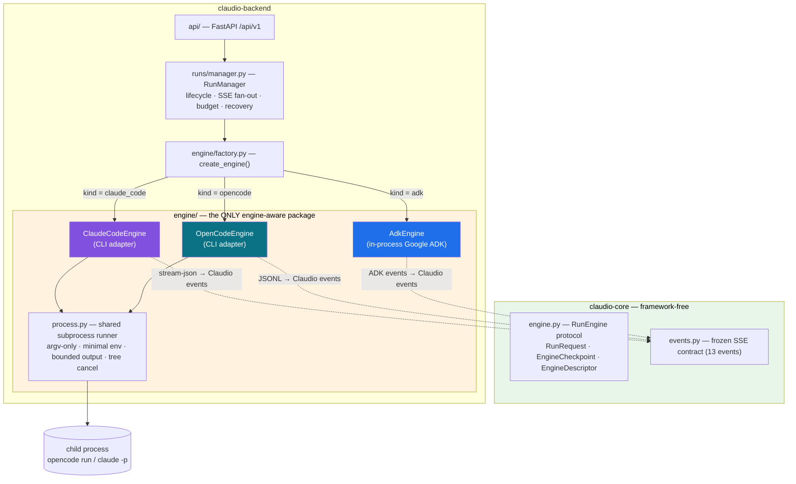
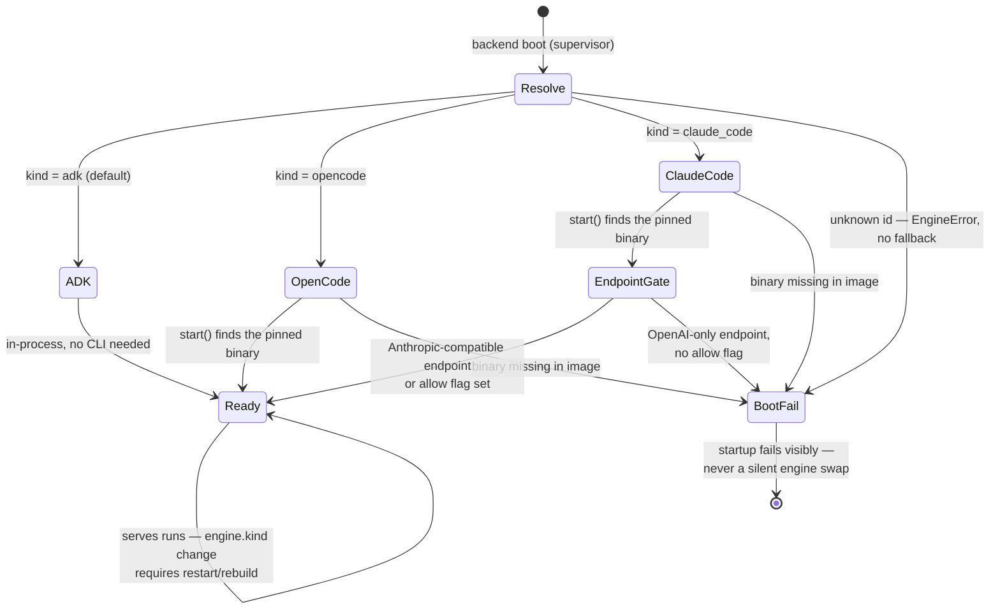
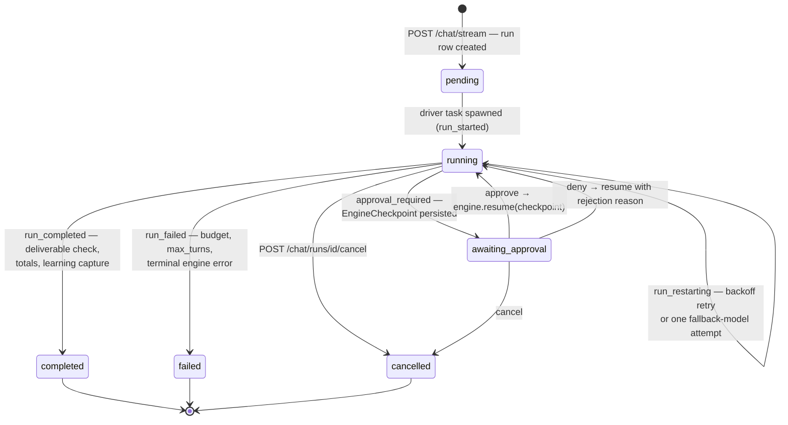
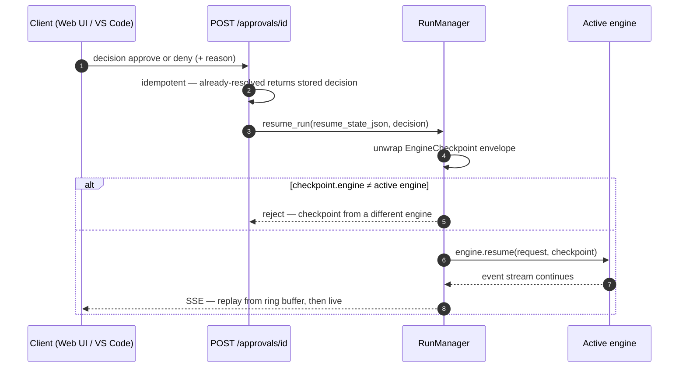
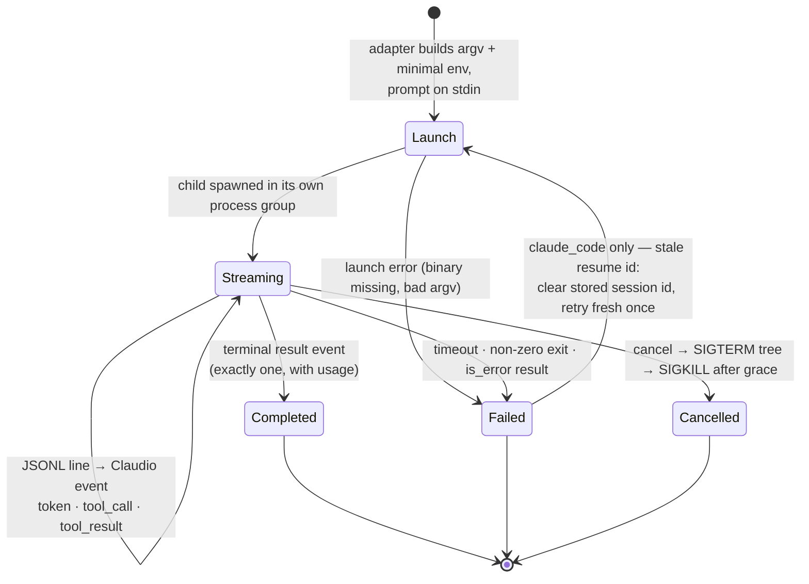

# Backend Engines — One Agent, Pluggable Brains (issue #57)

Claudio's backend can be driven by different **agent engines** behind one
factory, while the FastAPI surface, the SSE event contract, approvals, sessions
and tool policy stay identical. This document is the canonical reference for the
multi-engine architecture and the Claudio run flow.

- **Engine IDs:** `adk` (default, in-process Google ADK), `opencode`, `claude_code`.
- **Scope:** one engine per backend process — deployment-wide, **not** per
  session. Switching engines is a rebuild/restart, never a hot swap.
- Operational setup (Docker images, installer, env vars):
  [engine-setup.md](./engine-setup.md) and [docker.md](./docker.md).
  ADK-internal details (tool wrapping, confirmation round-trip):
  [backend.md](./backend.md).

---

## 1. The boundary that makes it possible

Two rules, both enforced mechanically by import-linter contracts rather than
convention:

1. **`claudio-core` imports no agent framework.** It defines the seam —
   `RunEngine` protocol, `RunRequest`, `EngineCheckpoint`, the frozen SSE
   event set — and knows nothing about ADK, OpenCode or Claude Code.
2. **`claudio_backend.engine` is the only package that may import a concrete
   engine or launch an engine CLI.** `api/` and `runs/` depend solely on the
   framework-neutral protocol.



Every engine yields the same `{"event": name, "data": {...}}` dicts defined by
`claudio_core/events.py`, and emits exactly one terminal event
(`run_completed` / `run_failed`). The RunManager — and therefore every client —
cannot tell which engine is driving.

---

## 2. Selection and startup

Resolution order (highest wins):

1. explicit `kind=` argument (tests),
2. `CLAUDIO_ENGINE` environment variable,
3. `engine.kind` in `config.yaml`,
4. default `"adk"`.

An unknown id raises `EngineError("unknown_engine")` — **there is no silent
fallback to ADK**, because a mis-set selector must surface, not quietly run a
different engine than the operator chose.

At boot the supervisor calls `engine.start()`, which validates the engine is
usable in this image and fails startup clearly if not:

| Engine | `start()` checks |
|---|---|
| `adk` | in-process library — nothing to find; always available |
| `opencode` | `shutil.which("opencode")` — binary must be baked into the image |
| `claude_code` | binary present **and** the endpoint gate (below) |

`reload_config()` refuses a changed `engine.kind`
(`engine_reload_requires_restart`): switching engines means a backend
restart/rebuild. The effective engine is reported by
`GET /api/v1/version` as `engine` / `engine_version` / `engine_capabilities`.



### Engine capabilities

Each engine declares an `EngineDescriptor` (id, version, capabilities). The run
manager and `/version` read these so the surface degrades honestly instead of
assuming ADK's abilities:

| Capability | adk | opencode | claude_code |
|---|---|---|---|
| streaming | ✅ | ✅ | ✅ |
| approvals | ✅ | ✅ | ✅ |
| tools | ✅ | ✅ | ✅ |
| compaction | ✅ | ✅ | ✅ |
| resume_after_restart | ✅ | ✅ | ✅ |
| usage_reporting | ✅ | ❌ (CLI reports none) | ✅ (result line carries usage + cost) |

---

## 3. The run lifecycle (engine-independent)

The RunManager owns run state; no client and no engine transitions it directly.
The engine only *proposes* terminal events; the manager persists them.



Notes:

- **A deny does not fail the run.** The rejection reason is fed back to the
  model as a tool response and the run continues (the model may take another
  route or answer without the action).
- **Recovery loop** (before a failure is final): proactive compaction, mid-run
  compaction capped at 5, exponential-backoff retries up to
  `llm.retry_attempts`, then one fallback-model attempt. A budget gate runs
  against the session's `total_cost_usd` before any work starts.
- **Reconnect semantics:** every event is recorded in the run's ring buffer;
  `GET /chat/runs/{run_id}/stream?last_event_id=N` replays the gap, so a
  dropped client connection loses nothing (see
  [architecture.md §5](./architecture.md#5-disconnect-and-reconnect-semantics)).

---

## 4. Approvals across engines — the checkpoint envelope

An approval pause must survive a process restart and must never be resumed by
the wrong engine. The pause state is therefore persisted as an **opaque,
versioned, engine-tagged envelope**:

```json
{ "engine": "claude_code", "schema_version": 1, "payload": { "...": "engine-owned" } }
```

The RunManager stores `resume_state_json` without interpreting `payload`, and
`EngineCheckpoint.validate_for(active_engine_id)` rejects a checkpoint
produced by a different engine. Each engine puts what *it* needs in the payload:

| Engine | Payload contents | Resume behaviour |
|---|---|---|
| `adk` | `AdkPauseState`: confirmation id, original call id, tool, args, hint | true mid-run resume — ADK feeds a `function_response` keyed by the **confirmation call's id** back into the resumable session |
| `opencode` | `native_session`, `call_id` | re-drives the CLI run with the decision; native pause state is not editable |
| `claude_code` | minimal (CLI has no mid-run pause) | re-drives `claude -p` with the stored CLI session (`--resume`) so context is kept |



---

## 5. CLI-backed engines — the shared subprocess runner

`opencode` and `claude_code` are child processes. All mechanics that must be
identical live in `engine/process.py`:

- **argv-only launch** (`create_subprocess_exec`, never a shell string) — prompt
  text is passed via **stdin**, so it can never be interpolated into a command.
- **Minimal environment** built explicitly (`build_env`), never the whole
  `.env`; the adapter adds only the credentials the CLI needs.
- **Explicit cwd** = the run's workspace.
- **Bounded output**: a single stdout line > 1 MB is an error (runaway-output
  guard); stdout is read line-by-line and each line is parsed at the boundary.
- **Per-run wall timeout** (`engine.run_timeout_seconds`, default 1800 s).
- **Cancellation kills the process tree**: the child runs in its own session;
  cancel sends SIGTERM to the group, SIGKILL after a 5 s grace.
- **Non-zero exit fails loudly**: after stdout EOF the exit code is checked; a
  failing CLI (bad flag, auth error, crash) raises with a stderr tail instead
  of letting the adapter synthesize an empty success.



Malformed or unknown native events are **ignored or surfaced as `run_failed` —
never fabricated into a success**. Launch/exit failures are marked
`retryable: false` (terminal) so the recovery loop does not replan forever
against a broken config.

### 5.1 Claude Code adapter specifics

| Concern | Behaviour |
|---|---|
| Invocation | `claude -p --output-format stream-json --verbose [--model M] --permission-mode <mode> [--resume <cli_session>]` — `--verbose` is **required** by `stream-json`; without it the CLI exits 1 with empty stdout ("no output" bug) |
| Endpoint gate | Claude Code speaks the **Anthropic Messages API** (`/v1/messages`), not OpenAI chat-completions. `start()` refuses against an endpoint that is not declared compatible: pass requires base_url containing `anthropic`, or `engine.claude_code.allow_openai_endpoint=true` (config) / `CLAUDE_CODE_ALLOW_OPENAI_ENDPOINT` / `CLAUDIO__ENGINE__CLAUDE_CODE__ALLOW_OPENAI_ENDPOINT` (env) after verifying a conversion gateway |
| Base URL normalisation | `llm.base_url` follows the OpenAI convention (`.../v1`); the CLI appends `/v1/messages` itself, so the adapter strips a trailing `/v1` before setting `ANTHROPIC_BASE_URL` (otherwise: `/v1/v1/messages`) |
| Model pinning | `llm.model` is passed as `--model` **and** `ANTHROPIC_MODEL` + `ANTHROPIC_SMALL_FAST_MODEL` (background helper calls otherwise default to a model id a custom gateway may not serve) |
| Conversation continuity | the CLI's own session id (from `system`/`result` lines) is persisted per Claudio session under `data/.../__engine__/claude-code-sessions/`; the next turn passes `--resume`. A stale id (config dir wiped by a rebuild) yields `engine_resume_stale` → the adapter clears it and retries fresh **once**, preserving the user's original message |
| Config dir | dedicated `CLAUDE_CONFIG_DIR` (and `HOME`) under the persistent data volume — never the operator's real home |
| Failure mapping | a `result` line with `is_error: true` (unknown model, auth problem, bad endpoint) is a **terminal** `run_failed` (`engine_config_error`) — the CLI exits 0 even when the run failed |
| Permission mode | `engine.claude_code.permission_mode`: `default` \| `acceptEdits` \| `plan`. No permission-bypass flag is ever used as a substitute for Claudio approvals |

### 5.2 OpenCode adapter specifics

| Concern | Behaviour |
|---|---|
| Invocation | `opencode run --format json`, prompt on stdin |
| Endpoint | any OpenAI-compatible endpoint — the same `llm.*` config Claudio already uses; child env gets `OPENAI_BASE_URL` / `OPENAI_API_KEY` only |
| Event mapping | `token`/`text`/`message` → `token`; `reasoning` → `reasoning`; `tool_call`/`tool-use` → `tool_call`; `tool_result`/`tool-result` → `tool_result`; `approval_required` → `approval_required` + checkpoint; `run_completed`/`run_failed` pass through |
| Usage | the CLI reports no usage → `usage_reporting: false`; token/cost gauges stay at zero rather than being estimated |

### 5.3 Conversation mirror (both CLI engines)

The CLI's native transcript is not editable, so compaction cannot rewrite it in
place. Each CLI engine keeps a **model-facing mirror**
(`__engine__/<engine>-mirror/<session_id>.json`): `get_conversation_items()`
reads it, `replace_conversation()` collapses it to a `[Compacted]` summary
block. The user-visible transcript in Claudio's own session store is unaffected.

---

## 6. Configuration

The `engine` section (see [configuration.md](./configuration.md)):

```yaml
engine:
  kind: claude_code            # adk | opencode | claude_code (CLAUDIO_ENGINE env wins)
  startup_timeout_seconds: 30  # version probe at start()
  run_timeout_seconds: 1800    # wall clock per CLI run
  opencode:
    binary: opencode
    config_dir: null           # default: private dir under backend data
  claude_code:
    binary: claude
    permission_mode: default   # default | acceptEdits | plan
    allow_openai_endpoint: false
```

Changing `engine.kind` requires a backend restart (and, for CLI engines, an
image built with the matching `ENGINE` build arg — see
[engine-setup.md](./engine-setup.md)).

---

## 7. What is proven vs. environment-dependent

The pluggable architecture, adapters, subprocess runner, factory, checkpoints
and deterministic tests (fake CLIs emitting known JSONL, no network) are
complete. Running against the **real** pinned OpenCode / Claude Code CLIs and a
**verified** Anthropic-compatible endpoint are the spec's go/no-go gates and
depend on your binaries and credentials — pin real CLI versions before
production use.
